# KataKiu customer app: Flutter architecture plan

> **Status:** plan, not implemented. Prepared 29 October 2026. No Flutter project exists yet. Start: [README.md](README.md) · requirements: [PRD.md](PRD.md) · schedule: [ROADMAP.md](ROADMAP.md) · tasks: [DELIVERY_PLAN.md](DELIVERY_PLAN.md) · evidence: [PROGRESS.md](PROGRESS.md) · agent rules: [AGENTS.md](AGENTS.md).
> **Scope:** the **customer mobile app** only. The merchant PWA and admin portal designs in `katakiu_mobile_ui_production/` are web clients and are out of scope here.
> **Principle:** MVP first. Build fewer screens that fully work against live endpoints rather than many screens on mock data. The Go backend is authoritative for eligibility, code use, claims and points; the app displays server results.

## Contents

1. [Architecture and dependency direction](#1-architecture-and-dependency-direction)
2. [Layers inside a feature](#2-layers-inside-a-feature)
3. [Project structure](#3-project-structure) (3.1 [Setting up the architecture](#31-setting-up-the-architecture), 3.2 [Flavours: dev and prod](#32-flavours-dev-and-prod))
4. [Design-to-feature map](#4-design-to-feature-map)
5. [Screens and UI components](#5-screens-and-ui-components)
6. [Key flows](#6-key-flows) (6.0 [Endpoint consumption by screen](#60-endpoint-consumption-by-screen))
7. [State ownership](#7-state-ownership)
8. [Errors, timeouts and offline](#8-errors-timeouts-and-offline)
9. [Security rules](#9-security-rules)
10. [Theme and design tokens](#10-theme-and-design-tokens)
11. [Dependencies](#11-dependencies)
12. [Testing](#12-testing)
13. [Delivery phases](#13-delivery-phases)
14. [Open questions](#14-open-questions)
15. [Sources](#15-sources)
16. [Backend endpoints: done and missing](#16-backend-endpoints-done-and-missing)

---

## 1. Architecture and dependency direction

The app uses a **feature-based DDD architecture with Riverpod**. Business logic lives in plain Dart, and external services sit behind adapters.

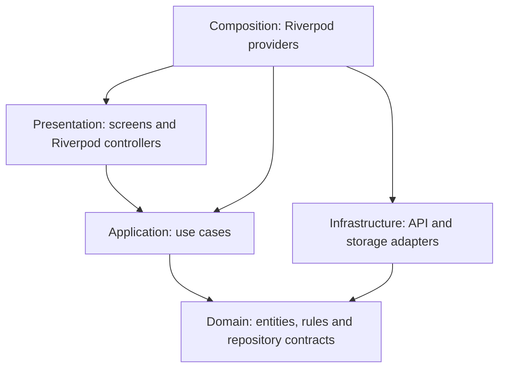

**Rules:**
- **Domain has no framework imports.** It never imports `flutter`, `riverpod`, `http`, `firebase` or storage packages. It defines entities, value objects and repository **contracts** (abstract classes).
- **Application** contains use cases: small classes with one public `call`. They depend only on domain contracts.
- **Infrastructure** implements the contracts. It maps API DTOs to domain types; DTOs never reach the presentation layer.
- **Presentation** contains widgets and Riverpod `Notifier`/`AsyncNotifier` controllers. Controllers call use cases.
- **Composition** happens in providers only. A provider builds a class and injects its dependencies; widgets never construct repositories.
- **Repository contracts need a reason.** Each contract has exactly one real implementation (HTTP). It exists so that tests can override it with a fake, which is the only reason to keep it (MVP rule: no abstractions without a second user).

## 2. Layers inside a feature

Each layer below has an example from `claims`.

| Layer | Contains | `claims` example |
|---|---|---|
| `domain/` | Entities, value objects, sealed outcomes, repository contract | `Claim` (id, ref, status, expiresAt, estimatedPoints), `ClaimStatus` enum, `ClaimRepository` |
| `application/` | Use cases, one per user intent | `OpenClaim`, `IssuePassCredential`, `RefreshClaim`, `CancelClaim`, `ListClaimHistory` |
| `infrastructure/` | DTOs, JSON mapping, HTTP repository | `HttpClaimRepository` calling `POST /api/v1/claims` through `ApiClient` |
| `presentation/` | Screens, widgets, controllers | `ScanScreen`, `ClaimReviewScreen`, `PassScreen`, `ClaimController` |

**What goes where:**
- **Point amounts** are value objects (`Points`) wrapping `BigInt`, parsed from the API's decimal strings. Doubles are never used.
- **Timestamps** stay UTC in the domain and are formatted for local time only in presentation.

## 3. Project structure

```text
lib/
  main.dart
  app/
    app.dart                 # MaterialApp.router, theme, ProviderScope
    router.dart              # go_router: routes + auth redirect
    providers.dart           # composition root: ApiClient, SessionStore, repositories
  core/
    network/
      api_client.dart        # the only HTTP entry point (see below)
      api_failure.dart       # sealed failure types mapped from envelope codes
    security/
      session_store.dart     # flutter_secure_storage wrapper (refresh token only)
    observability/
      log.dart               # redacting logger; Sentry adapter added later
    theme/                   # design tokens + KkTheme.light() (§10)
    ui/                      # shared components used by 2+ features (§5.3)
  features/
    home/                    # presentation only: composes wallet + claims
    identity/                # OTP sign-in, refresh, logout, profile, eligibility
    claims/                  # scan / manual entry, claim review, pass, status, history
    wallet/                  # balances, points statement, transaction details
    account/                 # account home, personal details, settings, legal pages
    rewards/                 # PLANNED: README only until D-06 (see §4)
test/                        # mirrors lib/
integration_test/            # one seeded-backend journey (dev flavour)
config/
  dev.json  prod.json        # public flavour config (§3.2); *.local.json git-ignored
android/app/src/dev/ src/prod/   # per-flavour manifest overrides, google-services.json (F5)
ios/config/dev/ prod/        # per-flavour GoogleService-Info.plist (F5)
```

**Inside a feature: one folder per screen.** Each screen folder holds the screen, its controller (if it has one) and a `widgets/` subfolder for widgets used **only by that page**. Example (`claims`):

```text
features/claims/
  domain/        claim.dart, claim_status.dart, points.dart, claim_repository.dart
  application/   open_claim.dart, issue_pass_credential.dart, refresh_claim.dart, cancel_claim.dart, list_claim_history.dart
  infrastructure/ claim_dto.dart, http_claim_repository.dart
  presentation/
    scan/
      scan_screen.dart
      scan_controller.dart
      widgets/
        scanner_frame.dart        # amber focus brackets
        manual_code_field.dart    # AB7K-92M4 entry + paste
        how_it_works_list.dart
    claim_review/
      claim_review_screen.dart    # "Eligible purchase found" → "Confirm this purchase"
      widgets/
        claim_summary_card.dart
    claim_pass/
      claim_pass_screen.dart      # "Show this QR to the merchant"
      pass_controller.dart
      widgets/
        pass_qr.dart
        expiry_countdown.dart
        pass_header.dart
    claim_status/
      claim_status_screen.dart    # confirmed / already used / expired / could not verify
```

**Promotion rule:**
- **A widget starts in its screen's `widgets/` folder.**
- **Sharing within a feature:** if another screen of the same feature needs it, move it to `features/<f>/presentation/widgets/`.
- **Sharing across features:** only when a second feature needs it does it move to `core/ui/`.
- **No speculative moves:** a widget is never moved up "in case".

The full screen tree for every feature is in §5.1.

**What the `ApiClient` owns.** All requests go through `core/network/api_client.dart`. It handles:
- the base URL `/api/v1` and JSON encoding;
- unwrapping the envelope (`success`, `message`, `data`, `errors`, `code`) into either `data` or an `ApiFailure`;
- the bearer token, and **one** refresh-and-retry on `401` (ID-03). Refreshes are single-flight: concurrent 401s share one refresh;
- sending `X-Request-ID` (a UUID) on every request and keeping the echoed value for support logs;
- an `Idempotency-Key` for critical mutations. The caller supplies a key per **logical attempt**, and a retry reuses the same key;
- timeouts (connect/receive). A timeout on a mutation becomes `ApiFailure.unknownOutcome`, never a "failed" result (see §8);
- mapping `429` together with `Retry-After` to `ApiFailure.rateLimited(retryAfter)`.

**What stays out of `core/`.** Shared code goes in `core/` only once two or more features need it. Widgets used by one feature stay in that feature.

### 3.1 Setting up the architecture

These steps belong to phase F0. They produce an empty but correctly wired app, and every later feature follows the same slice pattern.

1. **Create the project:** `flutter create --org com.katakiu --platforms android,ios katakiu_app`. Enable `flutter_lints` in `analysis_options.yaml`, and create the folders from §3 and §5.5. Folders for later phases are created when their phase starts, not in advance.
2. **Add F0 packages only:** `flutter pub add flutter_riverpod http go_router uuid`, then `flutter pub add --dev flutter_launcher_icons flutter_native_splash`. Other packages are added in their phase (§11). Bundle Inter under `assets/fonts/` and declare it in `pubspec.yaml`.
3. **Flavours and configuration:** set up the `dev` and `prod` flavours (§3.2). `app/config.dart` builds `AppConfig` once from `appFlavor` and `--dart-define-from-file=config/<flavour>.json`, and fails fast on a missing or mismatched value. The Android emulator reaches the host's backend at `10.0.2.2`.
4. **Entry point:** `main.dart` calls `runApp(const ProviderScope(child: KataKiuApp()))`. `KataKiuApp` builds `MaterialApp.router` with `theme: KkTheme.light()` from `core/theme` (§10) and `routerProvider`.
5. **Composition root:** `app/providers.dart` holds the infrastructure providers. Each feature has its own `providers.dart` for its repository, use cases and controllers.
6. **Router:** `routerProvider` builds a `GoRouter` whose `redirect` reads `sessionControllerProvider`. Without a session it routes to `/welcome`; once signed in, `/welcome` and `/sign-in/*` redirect to `/home`. The three tabs are a `StatefulShellRoute.indexedStack`, so each tab keeps its own stack.

**Provider dependency graph:**

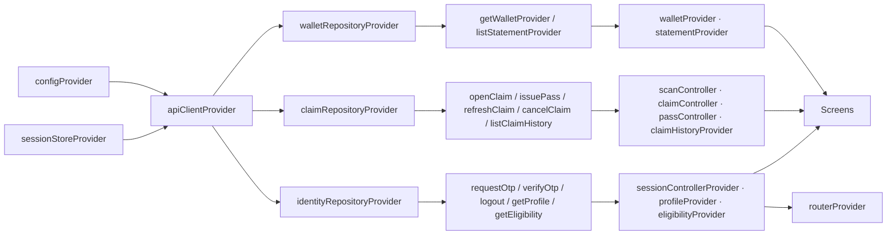

**One vertical slice, end to end (`wallet`):**

```dart
// core/network/api_client.dart: the only class that touches package:http
sealed class ApiFailure { const ApiFailure(); }
final class Unauthenticated extends ApiFailure { const Unauthenticated(); }
final class RateLimited extends ApiFailure { const RateLimited(this.retryAfter); final Duration retryAfter; }
final class UnknownOutcome extends ApiFailure { const UnknownOutcome(); }        // timeout on a mutation
final class ApiError extends ApiFailure { const ApiError(this.status, this.code, this.message, this.fieldErrors); final int status; final String code; final String message; final List<Map<String, dynamic>> fieldErrors; }

class ApiClient {
  Future<Map<String, dynamic>> get(String path, {Map<String, String>? query});
  Future<Map<String, dynamic>> post(String path, {Object? body, String? idempotencyKey});
  // Both return envelope `data`, or throw ApiFailure. Bearer, X-Request-ID,
  // timeouts and one single-flight refresh on 401 are handled inside.
}
```

```dart
// features/wallet/domain/
class Points { const Points(this.value); final BigInt value; factory Points.parse(String s) => Points(BigInt.parse(s)); }
class Wallet { const Wallet({required this.available, required this.pending}); final Points available, pending; }
abstract interface class WalletRepository { Future<Wallet> fetch(); }

// features/wallet/infrastructure/http_wallet_repository.dart
class HttpWalletRepository implements WalletRepository {
  HttpWalletRepository(this._api); final ApiClient _api;
  @override
  Future<Wallet> fetch() async {
    final d = await _api.get('/me/wallet');                        // LO-01
    return Wallet(available: Points.parse(d['available'] as String), pending: Points.parse(d['pending'] as String));
  }
}

// features/wallet/application/get_wallet.dart
class GetWallet { GetWallet(this._repo); final WalletRepository _repo; Future<Wallet> call() => _repo.fetch(); }

// features/wallet/providers.dart
final walletRepositoryProvider = Provider<WalletRepository>((ref) => HttpWalletRepository(ref.watch(apiClientProvider)));
final getWalletProvider = Provider((ref) => GetWallet(ref.watch(walletRepositoryProvider)));
final walletProvider = FutureProvider.autoDispose<Wallet>((ref) => ref.watch(getWalletProvider)());

// any screen: core/ui PointsBalanceCard fed by the provider
ref.watch(walletProvider).when(
  data: (w) => PointsBalanceCard(available: w.available, pending: w.pending),
  loading: () => const PointsBalanceCard.loading(),
  error: (e, _) => InfoBanner.error(messageFor(e)),
);
```

**Tests can swap the HTTP repository** for a fake with `ProviderScope(overrides: [walletRepositoryProvider.overrideWithValue(FakeWalletRepository())])`. This is the only reason the repository contract exists (§1).

### 3.2 Flavours: dev and prod

The app builds as two **flavours** from one codebase. Both can be installed side by side on the same device.

| Aspect | `dev` | `prod` |
|---|---|---|
| Android `applicationId` | `com.katakiu.app.dev` (`applicationIdSuffix ".dev"`) | `com.katakiu.app` (proposed, Q8) |
| iOS bundle ID | `com.katakiu.app.dev` | `com.katakiu.app` |
| App name on device | "KataKiu Dev" | "KataKiu" |
| Launcher icon / splash | Logo with a "DEV" badge | Logo |
| Config file | `config/dev.json` | `config/prod.json` |
| `API_BASE_URL` | Local or staging backend; `http://` allowed | `https://` only, otherwise startup fails |
| Cleartext HTTP | Allowed in the dev flavour only | Never |
| Debug-only routes (component gallery) | Debug builds only (`kDebugMode`) | Never registered |
| Logging | Verbose, always redacted | Warnings and errors only, redacted |
| Sentry `environment` / PostHog | `dev` (PostHog disabled or a separate project) | `prod` |
| Firebase project (F5) | `katakiu-dev` | `katakiu-prod` |
| Backend data | Seeded test data; accounts from [TEST_ACCOUNTS.md](../katakiu-backend/docs/TEST_ACCOUNTS.md) | Real data; seed test accounts must not exist |

**How it works.** Only native Gradle, Xcode and Flutter features are used; there is no flavour package such as `flutter_flavorizr`.

- **Android** (`android/app/build.gradle`): a single `env` flavour dimension with the following entries.
  ```groovy
  flavorDimensions "env"
  productFlavors {
      dev  { dimension "env"; applicationIdSuffix ".dev"; resValue "string", "app_name", "KataKiu Dev" }
      prod { dimension "env"; resValue "string", "app_name", "KataKiu" }
  }
  ```
  - The manifest uses `android:label="@string/app_name"`.
  - Per-flavour source sets hold the overrides: `src/dev/AndroidManifest.xml` sets `usesCleartextTraffic="true"`, and `src/dev|prod/google-services.json` is added in F5.
- **iOS** (Xcode):
  - **Build configurations:** `Debug-dev`, `Profile-dev`, `Release-dev`, `Debug-prod`, `Profile-prod`, `Release-prod`.
  - **Schemes:** shared `dev` and `prod` schemes. Flutter maps `--flavor dev` to the `dev` scheme.
  - **Per configuration:** each one sets `PRODUCT_BUNDLE_IDENTIFIER` and the display name through a user-defined `APP_DISPLAY_NAME` setting that `Info.plist` reads.
  - **Local HTTP:** the ATS exception for local HTTP exists only in the `*-dev` configurations.
  - **Firebase (F5):** a build phase copies `ios/config/<flavour>/GoogleService-Info.plist`.
- **Dart:** there is one `main.dart`, with no `main_dev.dart` or `main_prod.dart`. `app/config.dart` builds an `AppConfig` from two sources:
  - **the flavour,** from `appFlavor` (in `package:flutter/services.dart`). This needs a recent Flutter SDK; confirm it at F0 against the installed SDK [Likely];
  - **the defines,** from `--dart-define-from-file=config/<flavour>.json`: `FLAVOR`, `API_BASE_URL`, `SENTRY_DSN` and `POSTHOG_KEY`, read with `String.fromEnvironment`.

  At startup, `AppConfig` fails fast if:
  - the flavour is missing or unknown;
  - `appFlavor` does not match the config file's `FLAVOR` (a build passed the wrong file);
  - the flavour is prod and `API_BASE_URL` is not `https`.

  The flavour is read **only** in `app/config.dart` and the providers. Domain and application code never branch on it.
- **Config files.** `config/dev.json` and `config/prod.json` are committed with **public values only**: URLs and the flavour name. Secrets such as the Sentry DSN and PostHog key are added in CI with extra `--dart-define` flags and are never committed. `config/*.local.json` is git-ignored, for a developer's own LAN IP.
- **Icons.** Per-flavour icon and splash config lives in `flutter_launcher_icons-dev.yaml` / `-prod.yaml` and `flutter_native_splash-dev.yaml` / `-prod.yaml`.

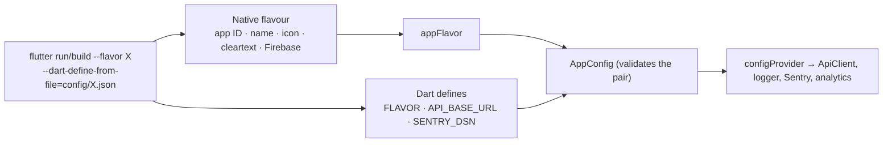

**Commands:**

| Task | Command |
|---|---|
| Run dev (Android emulator → local backend) | `flutter run --flavor dev --dart-define-from-file=config/dev.json` |
| Run dev on a physical device | `flutter run --flavor dev --dart-define-from-file=config/dev.local.json` (your LAN IP) |
| Run prod | `flutter run --flavor prod --dart-define-from-file=config/prod.json --release` |
| Android dev APK | `flutter build apk --flavor dev --dart-define-from-file=config/dev.json` |
| Android prod bundle | `flutter build appbundle --flavor prod --dart-define-from-file=config/prod.json --obfuscate --split-debug-info=build/symbols` |
| iOS prod archive | `flutter build ipa --flavor prod --dart-define-from-file=config/prod.json --obfuscate --split-debug-info=build/symbols` |

`config/dev.json` example: `{"FLAVOR": "dev", "API_BASE_URL": "http://10.0.2.2:8080"}`. A committed `.vscode/launch.json` has "KataKiu dev" and "KataKiu prod" entries with the same arguments.

## 4. Design-to-feature map

Status key:
- **Live:** the backend endpoint is implemented and documented in [customer-app.md](../katakiu-backend/docs/api/reference/customer-app.md).
- **Planned:** the screen depends on an operation that is not live.
- **Static:** the screen needs no backend.

| Design batch (folder) | Screens | Feature | Endpoints | Status |
|---|---|---|---|---|
| `katakiu_customer_onboarding_batch_1_1400_972` | Welcome, phone entry, OTP, age/eligibility gate | identity | ID-01 `POST /auth/otp/request`, ID-02 `POST /auth/otp/verify`, ID-05 `GET /me`, ID-11 `GET /me/eligibility` | **Live** for sign-in and reading the eligibility result. **Planned** for eligibility *submission*: fixture-only until D-02 |
| `katakiu_virtual_pass_batch_2_1400_972` | Pass active / refreshing / expired / connecting | claims | CL-03 `POST /claims/{id}/tokens` | **Live** as the per-claim credential QR. **Planned** for a standalone member pass: no endpoint issues a member-level credential |
| `katakiu_account_settings_batch_2_1400_972` | Notifications, privacy, terms, responsible participation, logout | account, identity | ID-04 `POST /auth/logout`; ID-13/14 for notification preferences | **Live** for logout. **Static** for the legal pages. **Planned** for notification preferences (ID-13/14) |
| `katakiu_activity_batch_3_1400_972` | Activity list, transaction detail, offline pass state | wallet, claims | LO-02 `GET /me/points`, CL-09 `GET /me/claims`, CL-02 `GET /claims/{id}` | **Live** |
| `katakiu_purchase_scan_batch_4_1400_972` | Scanner, manual code entry, how-it-works | claims | CL-01 `POST /claims` (`code_format`: `qr` or `manual`) | **Live** |
| `katakiu_purchase_claim_batch_5_1400_972` | Code verified, expected points, confirm or cancel claim | claims | CL-01 response, CL-03, CL-04 `POST /claims/{id}/cancel` | **Live** |
| `katakiu_purchase_status_batch_6_1400_972` | Pending, confirmed, expired, already redeemed | claims | CL-02 polling | **Live** |
| `katakiu_scan_error_batch_7_1400_972` | Invalid, spent, expired, recalled, not eligible | claims | CL-01 error codes (§8) | **Live** |
| `katakiu_rewards_batch_8_1400_972` | Rewards catalogue, reserve voucher | rewards | none | **Planned:** blocked by D-06 |
| `katakiu_redemption_batch_9_1400_972` | Redemption countdown, voucher reserved/used | rewards | none | **Planned:** D-06 |
| `katakiu_redemption_error_batch_10_1400_972` | Unavailable, already redeemed | rewards | none | **Planned:** D-06 |
| `katakiu_offline_redemption_batch_11_1400_972` | Timeout → "checking securely", do not resubmit | rewards | none | **Planned:** D-06. The *pattern* is reused now for claims (§8) |
| `katakiu_account_batch_12_1400_972` | Account home, profile, balance summary, recent activity | account, wallet | ID-05, LO-01 `GET /me/wallet`, LO-02 | **Live** |
| `katakiu_customer_mobile_test_board*` (3 boards) | Home in 3 states: returning user, first-time user (0 PTS + how earning works), pending verification | home | LO-01, CL-09 (recent activity) | **Live** |
| `mobile_loyalty_verification/DESIGN.md`, `katakiu_mobile_design_system_foundation` | Tokens, components | core/theme | n/a | **Static** (§10) |

ID-03 `POST /auth/refresh` is used inside `ApiClient` and has no screen. ID-17 `GET /me/access` is not needed by the customer app.

**Gaps to raise with the backend owner** (each needs a decision; none is assumed here; the full list with proposals is in §16):
- a standalone member pass;
- notification preferences (ID-13/14, planned);
- push device registration (ID-15/16, planned; blocks F5 push);
- onboarding steps 3–4: eligibility submission (D-02) and document consent (ID-10, planned);
- rewards (D-06).

## 5. Screens and UI components

### 5.1 Screen inventory and folders

Every screen in the customer designs is listed below. "State" screens (for example, pass active, refreshing or expired) are one screen widget that renders several states, not separate routes.

| Feature | Screen folder (`presentation/…`) | Route | Design | States / notes | Status |
|---|---|---|---|---|---|
| identity | `welcome/` | `/welcome` | batch 1 | Create account / I already have an account | Live |
| identity | `phone_entry/` | `/sign-in/phone` | batch 1 (step 1 of 4) | +254 prefix, validation, rate-limited | Live |
| identity | `otp_verify/` | `/sign-in/otp` | batch 1 (step 2 of 4) | 6 boxes, resend countdown, wrong code | Live |
| identity | `eligibility_gate/` | `/sign-in/eligibility` | onboarding steps 3–4 (not in board) | Shows the ID-11 result; submission is planned (D-02, ID-10) | Read live / submit planned |
| home | `home/` | `/home` (tab) | test boards | Returning user, first-time user, pending verification | Live |
| claims | `scan/` | `/scan` (tab) | batch 4 | Camera, manual entry, how it works, permission denied | Live |
| claims | `claim_review/` | `/claims/:id/review` | batch 5 | Eligible purchase found → confirm this purchase | Live |
| claims | `claim_pass/` | `/claims/:id/pass` | batch 5 + batch 2 | Active (countdown), refreshing, expired, offline | Live |
| claims | `claim_status/` | `/claims/:id/status` | batches 6, 7 | Confirmed, already used, expired, could not verify, connection unavailable, unknown | Live |
| wallet | `activity/` | `/activity` | batch 3 | All / Earned / Redeemed tabs, paginated, offline "last updated" | Live |
| wallet | `transaction_details/` | `/activity/:entryId` | batch 3 | Confirmed, pending, reversed | Live |
| account | `account_home/` | `/account` (tab) | batch 12 | Profile card, balance, menu | Live |
| account | `personal_details/` | `/account/details` | batch 12 | Read-only for the MVP ("Edit details" hidden until an endpoint exists) | Live (read) |
| account | `points_and_rewards/` | `/account/points` | batch 12 | Points tab live; Rewards tab hidden until D-06 | Live / planned |
| account | `notification_settings/` | `/account/notifications` | settings batch 2 | Toggles | Planned (ID-13/14); row disabled, as in the design |
| account | `terms_and_privacy/` | `/account/legal` | settings batch 2 | Links open with `url_launcher` | Static |
| account | `logout_confirm/` | `/account/logout` | settings batch 2 | Log out / cancel | Live (ID-04) |
| rewards | `rewards_list/`, `reward_detail/`, `redemption/`, `redemption_result/` | — | batches 8–11 | Not built | Planned (D-06) |

### 5.2 Navigation map

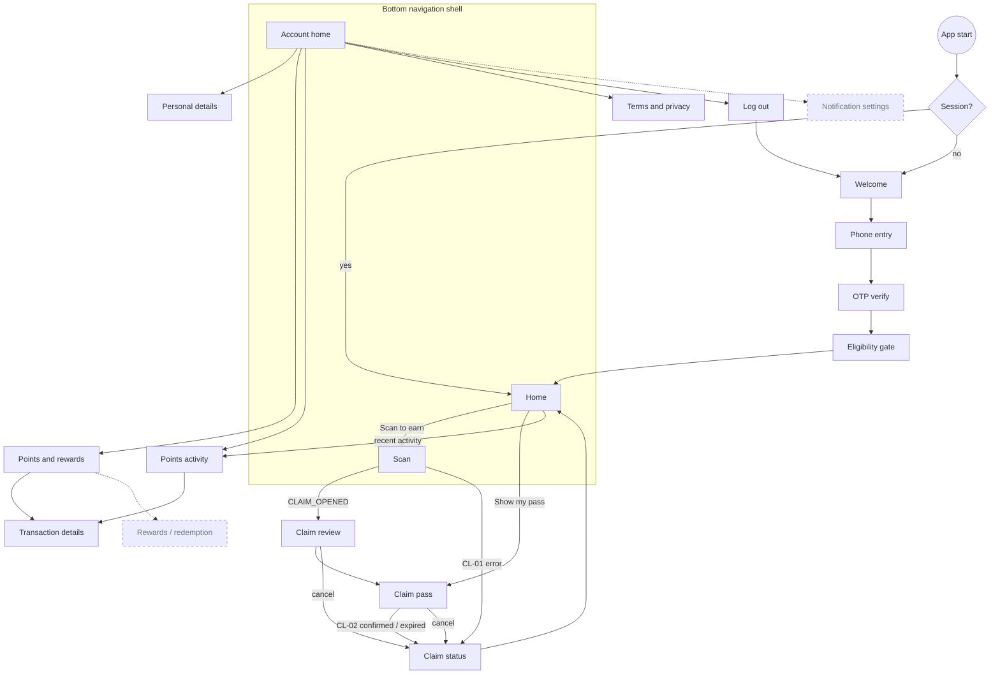

Dashed boxes are planned screens. "Show my pass" opens the pass for the current pending claim. With no pending claim, it routes to Scan until a standalone member pass exists (see the §4 gaps).

### 5.3 Shared components (`lib/core/ui/`)

These components are used by **two or more features**, so they start in `core/ui/`. Everything else starts in a screen's `widgets/` folder.

| Component | Used by | States / variants (from the designs) | Tokens used (§10.3) |
|---|---|---|---|
| `KkAppBar` | every screen | Back arrow, title, optional trailing action (lock, share, menu) | `KkText.appBar`, `KkColors.white`/`divider`, `KkSize.iconLg` |
| `KkBottomNav` | home, claims, account | Home, Scan, Account. Active tab in teal; the Scan dot shows while a claim is pending | `NavigationBarThemeData`, `KkText.navLabel`, `teal`/`textSecondary` |
| `PointsBalanceCard` | home, wallet, account, claims (pass) | Midnight card: available points, "N pending" amber chip, optional "Last updated" (offline), zero balance | `midnight`, `aqua`, `KkText.balance`, `KkRadius.standardAll`, `KkInsets.card`, `pending` status set |
| `StatusChip` | home, wallet, claims, account | Confirmed (teal), Pending (amber), Redeemed / Reversed (coral), Verified, Offline, Expired | `KkStatusColors`, `KkRadius.chipAll`, `KkSize.chipHeight`, `KkText.chip`, `KkInsets.chip` |
| `ActivityRow` | home, wallet, account | Title, place · time, signed points (teal + / coral −), optional chip | `KkText.body`/`helper`, `success`/`coralText`, `KkInsets.listRow`, `StatusChip` |
| `InfoBanner` | all features | Info, success (teal tint), pending (aqua tint), lock / security note, warning (coral) | `KkStatusColors`, `KkRadius.standardAll`, `KkSpace.md` |
| `KeyValueList` | claims, wallet, account | Label/value rows with 1 px dividers; monospace value variant for refs and member IDs | `KkText.body`/`helper`/`mono`, `divider`, `KkSpace.md` |
| `PrimaryButton` / `SecondaryButton` / `DestructiveButton` | all features | Teal filled, outline and coral filled; each has loading and disabled states (one request in flight) | `FilledButtonThemeData`/`OutlinedButtonThemeData`, `KkButtonStyles`, `KkSize.buttonHeight`, `KkText.button` |
| `ResultScreenScaffold` | claims, identity (errors), later rewards | Icon in a circle, headline, body, optional details card, primary and secondary action | `KkText.section`/`body`, `KkStatusColors`, `KkSpace.xl` |
| `SegmentedTabs` | wallet, account | All / Earned / Redeemed; Points / Rewards | `white`/`surfaceSoft`, `KkText.button`, `KkRadius.standardAll` |
| `NavListTile` | account | Title, subtitle, chevron; disabled variant (Notification settings) | `ListTileThemeData`, `KkSize.listRowMinHeight`, `textSecondary` |

`StepHeader` ("STEP n OF 4") is used only by onboarding, so it stays in `identity/presentation/widgets/`.

One shared `formatPoints(Points)` in `core/ui/format.dart` formats points (for example "1,840 PTS"), so every component shows them the same way.

### 5.4 Widget composition (examples)

These three screens show the pattern: screen → its own `widgets/` → `core/ui` components.

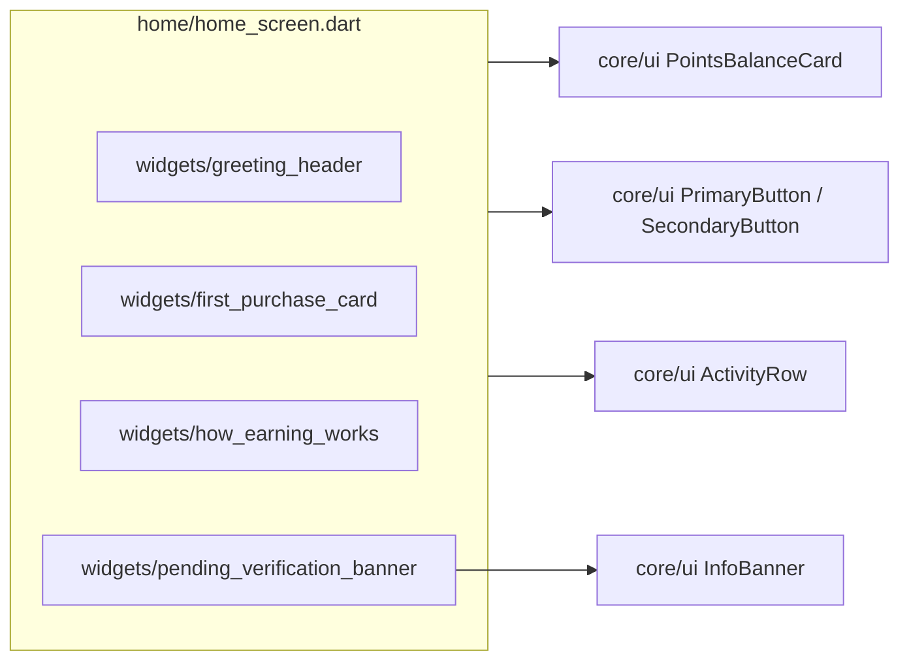

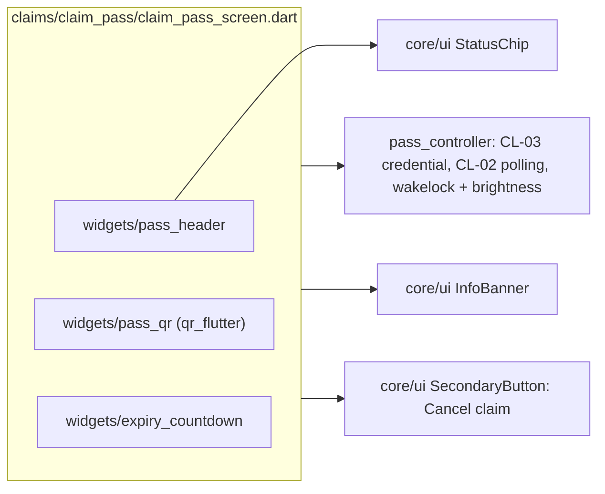

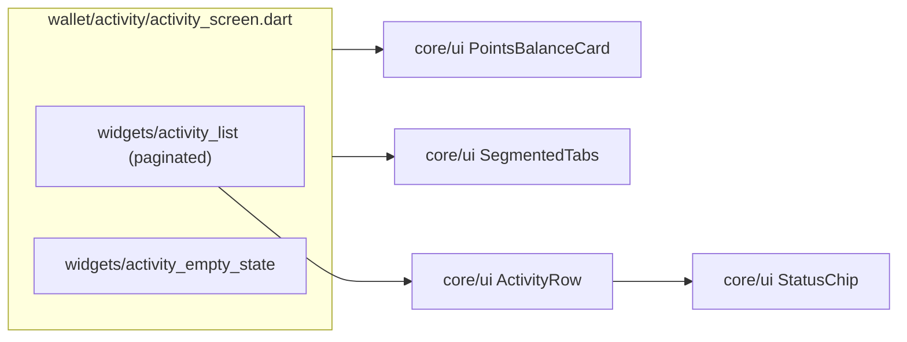

### 5.5 Full presentation tree

```text
lib/
  core/theme/
    kk_colors.dart  kk_typography.dart  kk_spacing.dart  kk_radius.dart  kk_sizes.dart  kk_shadows.dart
    kk_status_colors.dart  kk_button_styles.dart  kk_theme.dart  theme_context.dart
  core/ui/
    kk_app_bar.dart  kk_bottom_nav.dart  points_balance_card.dart  status_chip.dart
    activity_row.dart  info_banner.dart  key_value_list.dart  buttons.dart
    result_screen_scaffold.dart  segmented_tabs.dart  nav_list_tile.dart  format.dart
  features/
    home/presentation/home/
      home_screen.dart
      widgets/ greeting_header.dart  first_purchase_card.dart  how_earning_works.dart  pending_verification_banner.dart
    identity/presentation/
      widgets/ step_header.dart                     # shared by onboarding screens only
      welcome/          welcome_screen.dart
      phone_entry/      phone_entry_screen.dart     widgets/ kenya_phone_field.dart
      otp_verify/       otp_verify_screen.dart      otp_controller.dart  widgets/ otp_boxes.dart  resend_countdown.dart
      eligibility_gate/ eligibility_gate_screen.dart
    claims/presentation/
      scan/             scan_screen.dart  scan_controller.dart  widgets/ scanner_frame.dart  manual_code_field.dart  how_it_works_list.dart  camera_permission_notice.dart
      claim_review/     claim_review_screen.dart  widgets/ claim_summary_card.dart
      claim_pass/       claim_pass_screen.dart  pass_controller.dart  widgets/ pass_header.dart  pass_qr.dart  expiry_countdown.dart
      claim_status/     claim_status_screen.dart  widgets/ code_details_card.dart
    wallet/presentation/
      activity/             activity_screen.dart  statement_controller.dart  widgets/ activity_list.dart  activity_empty_state.dart
      transaction_details/  transaction_details_screen.dart  widgets/ transaction_hero.dart
    account/presentation/
      account_home/          account_home_screen.dart  widgets/ profile_card.dart  responsible_note.dart
      personal_details/      personal_details_screen.dart
      points_and_rewards/    points_and_rewards_screen.dart
      notification_settings/ notification_settings_screen.dart   # planned (ID-13/14)
      terms_and_privacy/     terms_and_privacy_screen.dart  widgets/ support_links.dart
      logout_confirm/        logout_confirm_screen.dart
    rewards/README.md        # planned (D-06)
```

## 6. Key flows

### 6.0 Endpoint consumption by screen

**Every call follows the same path:** screen → controller/provider → use case → repository → `ApiClient` → endpoint. Screens never call `ApiClient` directly.

"Planned" rows say what the screen does until the backend endpoint exists. §16 lists those endpoints.

| Screen | Trigger | Controller / provider | Use case | Endpoint | Fields used | Errors handled | After success |
|---|---|---|---|---|---|---|---|
| Welcome | — | — | — | none | — | — | Navigate to phone entry |
| Phone entry | Tap Continue | `otpController` | `RequestOtp` | ID-01 `POST /auth/otp/request` (`purpose: sign_in`, `client_type: customer_app`) | `challenge_id`, `expires_at`, `retry_after_seconds` | `VALIDATION_FAILED` (phone), `RATE_LIMITED` | Go to OTP, start resend countdown |
| OTP verify | Tap Verify / 6th digit | `otpController` → `sessionController` | `VerifyOtp` | ID-02 `POST /auth/otp/verify` | `access_token`, `refresh_token`, `expires_at` | `OTP_INVALID`, `VALIDATION_FAILED` | Save refresh token; router redirects |
| OTP verify | Tap Resend (after countdown) | `otpController` | `RequestOtp` | ID-01 | `challenge_id`, `retry_after_seconds` | `RATE_LIMITED` | Replace challenge |
| Eligibility gate | Screen open (after sign-in) | `eligibilityProvider` | `GetEligibility` | ID-11 `GET /me/eligibility` | `outcome`, `expires_at` | 404 = no result yet | Approved → `/home`; otherwise explainer |
| Eligibility gate | Submit evidence / accept terms | — | — | **Planned:** ID-12, ID-10 | — | — | MVP: show the explainer and support link |
| Home | Tab open, pull-to-refresh | `profileProvider` | `GetProfile` | ID-05 `GET /me` | `display_name` ("Habari, Amina") | 401 handled by `ApiClient` | — |
| Home | Tab open, pull-to-refresh | `walletProvider` | `GetWallet` | LO-01 `GET /me/wallet` | `available`, `pending` | generic error banner | Zero → first-time state |
| Home | Tab open | `claimHistoryProvider(limit: 3)` | `ListClaimHistory` | CL-09 `GET /me/claims?limit=3` | `status`, `product.name`, `estimated_customer_points` | — | A pending claim → "Pending verification" banner and "Show my pass" target |
| Home | Tab open | `statementProvider(limit: 3)` | `ListStatement` | LO-02 `GET /me/points?limit=3` | `delta`, `kind`, `created_at` | — | Recent activity rows |
| Scan | QR detected / manual Check code | `scanController` | `OpenClaim` | CL-01 `POST /claims` + `Idempotency-Key` (`product_code`, `code_format`) | `id`, `status`, `product`, `expires_at`, `estimated_customer_points` | `CODE_INVALID`, `CODE_ALREADY_SPENT`, `BATCH_RECALLED`, `CAMPAIGN_NOT_ELIGIBLE`, `RULE_HOLD_UNSUPPORTED`, `ELIGIBILITY_REQUIRED`, `UnknownOutcome` | Drop the raw code; go to claim review |
| Claim review | Screen open | `claimController(id)` (seeded from the CL-01 result) | — | none (uses the CL-01 response) | `product.name`, `estimated_customer_points`, `expires_at` | — | — |
| Claim review | Tap Cancel claim | `claimController(id)` | `CancelClaim` | CL-04 `POST /claims/{id}/cancel` + key | `status` | `STATE_CONFLICT` → re-read CL-02 | Status screen |
| Claim pass | Screen open / Refresh pass | `passController(id)` | `IssuePassCredential` | CL-03 `POST /claims/{id}/tokens` + key | `credential`, `expires_at` | `STATE_CONFLICT`, `CLAIM_NOT_FOUND` | Render QR and countdown |
| Claim pass | Every 3 s while visible | `claimController(id)` | `RefreshClaim` | CL-02 `GET /claims/{id}` | `status`, `purchase_id` | Network error → keep the last state and retry | `confirmed` / `expired` / `cancelled` → status screen |
| Claim status | Screen open | `claimController(id)` | `RefreshClaim` | CL-02 | `status`, `product.name`, `estimated_customer_points` | `CLAIM_NOT_FOUND` | On confirmed: invalidate wallet, statement and history |
| Activity | Screen open, tab change, scroll end | `statementProvider(kind)` | `ListStatement` | LO-02 `GET /me/points?limit=20&kind=…&cursor=…` | `items[].delta/kind/bucket/created_at/purchase_id`, `pagination` | `VALIDATION_FAILED` (stale cursor → restart) | Append page |
| Transaction details | Tap a row | `transactionProvider(entryId)` | `GetTransaction` | Entry from the LO-02 page in memory + CL-09 match on `purchase_id` | `delta`, `created_at`, `claim_ref`, `product.name` | — | Merchant and location rows hidden until §16 item N-2 |
| Account home | Tab open | `profileProvider`, `walletProvider` (shared with Home) | `GetProfile`, `GetWallet` | ID-05, LO-01 | `display_name`, `phone_e164`, `eligibility_status`, `available`, `pending` | — | — |
| Personal details | Screen open | `profileProvider` | — | ID-05 (cached) | `display_name`, `phone_e164`, `member_ref`, `eligibility_status`, `status` | — | "Edit details" hidden: **planned** ID-06 |
| Points and rewards | Screen open | `statementProvider` | `ListStatement` | LO-02 | as in Activity | — | Rewards tab hidden: **planned** RE-07 |
| Notification settings | — | — | — | **Planned:** ID-13/14 | — | — | Row disabled (as in the design) |
| Terms and privacy | Tap a row | — | — | none (static); later ID-09 | — | — | `url_launcher` opens the page |
| Log out | Tap Log out | `sessionController` | `Logout` | ID-04 `POST /auth/logout` | — | Any error still clears locally | Delete refresh token, invalidate account providers, `/welcome` |

**Activity tabs.** The only `kind` live today is `purchase_award`:
- "All" sends no filter;
- "Earned" sends `kind=purchase_award`;
- "Redeemed" stays hidden until redemption (RE-03) creates entries of that kind.

**Cache and refresh rules:**
- **Shared reads.** Home and Account watch the **same** `walletProvider` and `profileProvider`, so one fetch serves both.
- **Invalidation.** A confirmed claim invalidates `walletProvider`, `statementProvider` and `claimHistoryProvider`. Logout invalidates every account-scoped provider (§7).
- **Pull-to-refresh** on Home, Activity and Account calls `ref.invalidate` on that screen's providers. There is no background refresh in the MVP.
- **Polling** belongs to `claimController` and stops in `ref.onDispose` when the pass screen closes.

### 6.1 Sign-in, refresh and logout

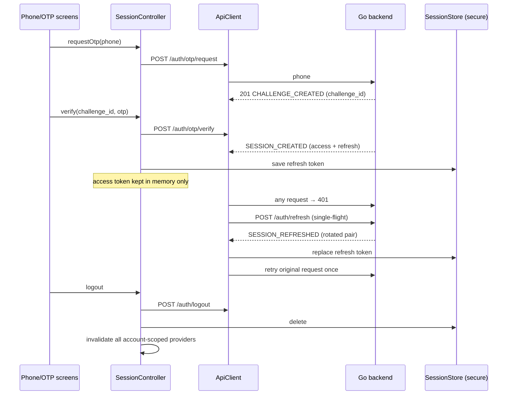

**Refresh failures.** If the refresh returns `REFRESH_REUSED` or `SESSION_REVOKED`, or a second `401` arrives, the app clears the session and routes to sign-in. Under `RATE_LIMITED`, the OTP button stays disabled for `Retry-After` seconds.

### 6.2 Purchase claim (scan → pass → merchant confirmation)

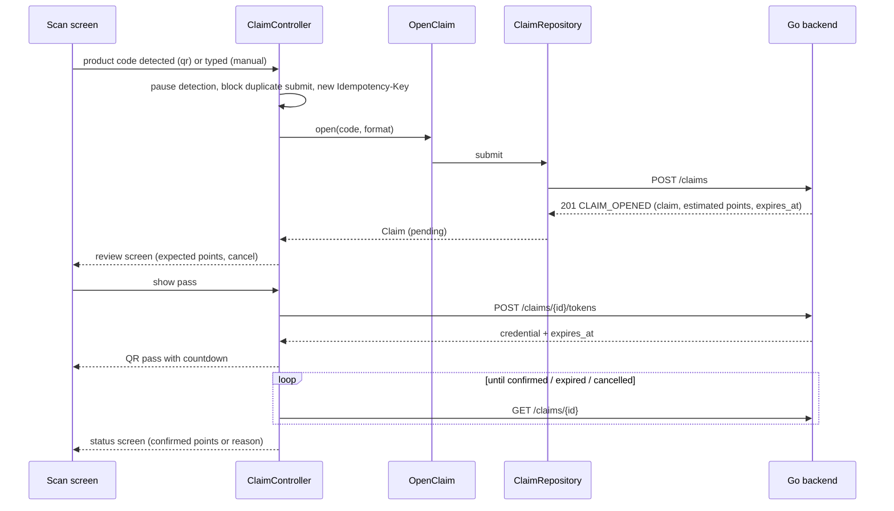

**Rules for the claim flow:**
- **The scanner reads QR codes only:** `MobileScannerController(formats: [BarcodeFormat.qrCode])`. The bottle's retail EAN-13/GTIN barcode sits on the same label, and CL-01 accepts only `code_format: qr | manual`. If the scanner accepted all formats, it could submit the retail barcode and get `CODE_INVALID`. Limiting the formats also speeds up detection.
- **The code leaves the device only once.** After CL-01, the raw product code is dropped from memory. It is never stored, logged or sent to analytics.
- **The pass credential lives in memory only.** When it expires, the pass shows its "expired" design, and **Refresh pass** issues a new credential with CL-03 under a new key.
- **The pass screen stays readable.** While the pass is visible, `wakelock_plus` keeps the screen on, and `screen_brightness` raises the brightness so the merchant's camera can read the QR. Both are restored when the screen is left or the app goes to the background.
- **Polling is simple.** The claim is checked every few seconds (interval proposed: 3 s) while the pass is visible, and polling stops when the screen leaves. Push replaces polling only after F5.
- **Points shown before confirmation are labelled "expected".** Only the confirmed claim and the wallet show awarded points (business invariant 1).

### 6.3 Claim state machine (client view)

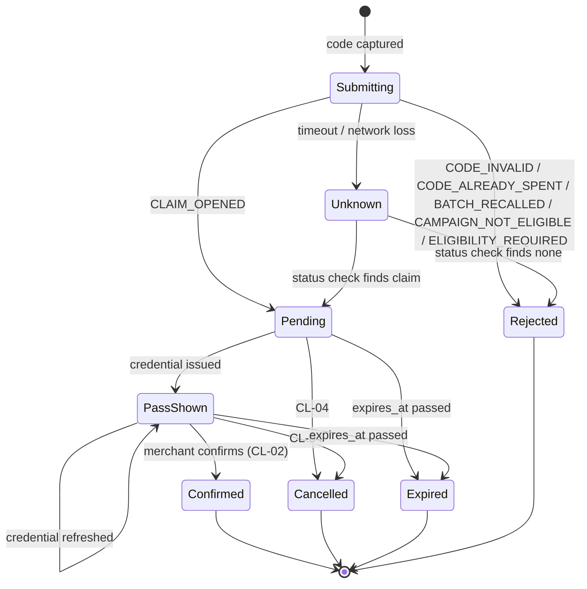

**Resolving `Unknown` in the MVP.** A timed-out CL-01 is replayed with the **same** `Idempotency-Key` and the same body. The backend then returns the original outcome instead of creating a second claim. If the replay is impossible (for example, the app was killed), the app checks CL-09 history for the most recent claim.

### 6.4 Wallet and statement

- **Balances:** `GET /me/wallet` returns available and pending balances as decimal strings, parsed into `Points`.
- **Statement:** `GET /me/points?limit=20&cursor=…` is cursor-paginated. The cursor is bound to the filters, so changing a filter starts again from the first page.
- **The statement is immutable.** It is append-only on the server, so the client never edits or merges entries. It only appends pages.

## 7. State ownership

| State | Owner |
|---|---|
| Expanded panel, field visibility | Local widget state |
| Camera detection and scan submission | `ScanController` (pauses the scanner while submitting) |
| Pending / confirmed / expired claim | `ClaimController` (family by claim id) |
| Pass credential and countdown | `PassController`: memory only, disposed with the screen |
| Authentication session | `SessionController` + `SessionStore` |
| Wallet and statement | `walletProvider`, `statementProvider` (`AsyncNotifier`, paginated) |
| Profile and eligibility result | `profileProvider`, `eligibilityProvider` |
| Eligibility, code usage and point balances | **The Go backend.** Flutter only displays server results |

**On logout or session loss,** every account-scoped provider is invalidated through one `ref.invalidate` list in `SessionController`, so the next user sees no residue.

## 8. Errors, timeouts and offline

These are the error codes live customer endpoints return (from the generated [errors.md](../katakiu-backend/docs/api/reference/errors.md)):

| Code | Where | App behaviour |
|---|---|---|
| `VALIDATION_FAILED` | any form | Show field errors from `errors[]` |
| `UNAUTHENTICATED` | any | One refresh and retry, then sign-in |
| `OTP_INVALID` | ID-02 | "Code incorrect", allow retry |
| `RATE_LIMITED` | ID-01 | Disable resend for `Retry-After` seconds |
| `REFRESH_REUSED` / `SESSION_REVOKED` | ID-03 | Clear session, go to sign-in |
| `ELIGIBILITY_REQUIRED` | CL-01 | Eligibility explainer (onboarding batch) |
| `CODE_INVALID` | CL-01 | Scan error: "Check the code and try again" |
| `CODE_ALREADY_SPENT` | CL-01 | Scan error: "This code has already been used" |
| `BATCH_RECALLED` / `CAMPAIGN_NOT_ELIGIBLE` / `RULE_HOLD_UNSUPPORTED` | CL-01 | Scan error: product not eligible |
| `STATE_CONFLICT` | CL-03/CL-04 | Re-read the claim with CL-02 and show its real state |
| `CLAIM_NOT_FOUND` / `NOT_FOUND` | CL-02/03/04 | "Claim not found", back to scan |
| `IDEMPOTENCY_CONFLICT` | mutations | Programming error: log it (redacted), show a generic error |

**Timeouts and offline rules** (business invariant 9):
- **A timeout is an unknown outcome**, not a failure. The UI shows the "checking securely, do not submit again" pattern from batch 11 and resolves it as described in §6.3.
- **Offline, the app never finalises anything.** It can show the **last fetched** wallet and activity, labelled "Last updated …" as in batch 3's offline design. Those cached reads are held in memory only for the MVP; disk caching waits for a real need.
- **The pass cannot be shown offline**, because CL-03 needs the server. Show batch 3's "Live pass unavailable" state.

## 9. Security rules

- **Nothing sensitive is written down.** Product codes, pass credentials, OTPs and tokens never reach logs, analytics, crash reports or persistent storage. The logger redacts any field whose name matches `code|credential|otp|token|authorization`.
- **Secure storage holds only the refresh token.** The access token stays in memory.
- **Logout and session loss clear everything** account-scoped, including the provider state in §7.
- **One request per mutation.** Buttons disable while their request is in flight. Retries reuse the same `Idempotency-Key`.
- **No test bypasses ship.** Test OTP `123456` is a backend fixture for development. The app never hardcodes it, and it and the seeded test accounts are only ever used with the **dev** flavour.
- **Flavour separation (§3.2):** prod requires an `https` base URL, or startup fails. Cleartext HTTP is allowed only in the dev flavour's manifest and ATS settings. No secrets are committed in `config/*.json`; CI injects them.
- **External links** (terms, privacy, support) open through `url_launcher` with an allow-list of KataKiu URLs. Links never carry tokens or IDs.
- **Release builds** use `--obfuscate --split-debug-info`. This is a hygiene measure, not a security control.
- **Platform configuration is required.** `flutter_secure_storage` gives platform-specific protection only when configured correctly (Android `encryptedSharedPreferences`, iOS Keychain accessibility). See [pub.dev](https://pub.dev/packages/flutter_secure_storage).

## 10. Theme and design tokens

The source is [DESIGN.md](katakiu_mobile_ui_production/mobile_loyalty_verification/DESIGN.md), the "Mobile Loyalty & Verification" design system. This section turns it into **reusable Dart constants** and one Material theme. It is a light theme only; dark mode is out of the MVP until a design exists.

### 10.1 Principles

- **Flat.** There are no gradients, glows or blur. Depth comes from surface colour and 1 px dividers; one subtle shadow is allowed, for floating elements only.
- **Tokens come from DESIGN.md.** When the design changes, change the token, not the widgets.
- **No raw styling outside `lib/core/theme/`.** That means no `Color(0x…)`, `Colors.*` (except `transparent`), `fontSize:` or numeric paddings and radii in widgets. Widgets read the token constants, `Theme.of(context)` or `context.kk`, and a test enforces this (§10.5).
- **Brand palette first.** `KkColors` is built from the brand palette (Teal, Amber, Midnight and the others). The YAML Material-3 roles in DESIGN.md are used only where they supply accessible text colours (§10.7).

### 10.2 File layout

The theme lives in `core`, because the `core/ui` components consume it and `core` must not import `app`. `app/app.dart` only applies `KkTheme.light()`.

```text
lib/core/theme/
  kk_colors.dart         # brand palette, chip tints, accessible text colours, semantic aliases
  kk_typography.dart     # KkText: Inter TextStyles per role + TextTheme mapping
  kk_spacing.dart        # KkSpace scale, KkInsets, KkGap SizedBoxes
  kk_radius.dart         # KkRadius values + BorderRadius constants
  kk_sizes.dart          # KkSize: heights, touch targets, icon sizes, border width
  kk_shadows.dart        # KkShadows.floating (the only shadow)
  kk_status_colors.dart  # ThemeExtension<KkStatusColors>: confirmed / pending / rejected / neutral sets
  kk_button_styles.dart  # KkButtonStyles.scan (amber), destructive, destructiveFilled
  kk_theme.dart          # KkTheme.light(): ColorScheme + component themes
  theme_context.dart     # extension on BuildContext: context.kk (status colours), context.text
```

### 10.3 Token constants

**Colours (`KkColors`, all `static const Color`)**

| Constant | Value | DESIGN.md source | Used for |
|---|---|---|---|
| `teal` | `#0DB3A0` | Teal | Filled buttons, active tab, confirmed borders, progress |
| `tealText` | `#006B5F` | YAML `primary` | Teal **text** and links on light surfaces (6.43:1 on white) |
| `amber` | `#FFB547` | Amber | Scanner brackets, scan trigger button, pending borders, temporal notices |
| `midnight` | `#071724` | Midnight | Primary text, headings, loyalty summary card |
| `aqua` | `#7AE1D6` | Aqua | Helper labels on Midnight, pending tints, confirmed chip border |
| `coral` | `#EF6A6A` | Coral | Destructive borders and fills, rejected/reversed indicators, error input border |
| `coralText` | `#BA1A1A` | YAML `error` | Error and reversed **text** on light surfaces (6.46:1 on white) |
| `white` | `#FFFFFF` | White | Cards, app bar, bottom nav, inputs |
| `surfaceSoft` | `#F5F7F8` | Soft neutral surface | Screen canvas, ripple, secondary containers |
| `divider` | `#E6EAED` | Divider | 1 px borders and separators |
| `textSecondary` | `#66737D` | Secondary text | Subtext, timestamps, unselected icons (4.87:1 on white) |
| `confirmedBg` | `#E6F7F5` | Chip: verified/confirmed | Confirmed chip and banner background |
| `pendingBg` | `#FFF7EB` | Chip: pending | Pending chip and banner background |
| `rejectedBg` | `#FDECEC` | Chip: rejected/expired | Rejected chip and banner background |

**Semantic aliases** (use these names in widgets; they point at the constants above):

| Alias | Points at |
|---|---|
| `textPrimary` | midnight |
| `canvas` | surfaceSoft |
| `card` | white |
| `success` | teal |
| `pending` | amber |
| `danger` | coral |
| `info` | aqua |

**Typography (`KkText`, Inter, `height = lineHeight / fontSize`)**

| Constant | Size / weight / line height | Role (DESIGN.md) | Material `TextTheme` slot |
|---|---|---|---|
| `balance` | 22 / 700 / 28 | Main numerical value (balances) | `headlineSmall` |
| `headline` | 22 / 700 / 28 (provisional) | Screen headline (not in tokens; §10.7 d) | `headlineMedium` |
| `section` | 16 / 600 / 22 | Section heading, sheet title | `titleMedium` |
| `appBar` | 14 / 500 / 20 | App-bar title | `titleSmall` |
| `button` | 13 / 600 / 18 | Primary and secondary action label | `labelLarge` |
| `body` | 12 / 400 / 18 | Body text, detail rows, policy text | `bodyMedium` |
| `navLabel` | 12 / 500 / 16 | Bottom-navigation label | `labelMedium` |
| `chip` | 11 / 500 / 14 | Status chip and tag | `labelSmall` |
| `helper` | 11 / 400 / 16 | Helper, validation, timestamps, references | `bodySmall` |
| `mono` | 12 / 400 / 18, monospace | Member IDs, claim refs, codes | — |

The designs also show screen headlines ("Rewards made simple.", "Habari, Amina") that are not in the token list. Until the designer confirms, they use **`KkText.headline` = 22 / 700 / 28** (the same metrics as `balance`, Material slot `headlineMedium`) (§10.7 d).

**Spacing (`KkSpace`, `static const double`)**

| Constant | Value | Used for |
|---|---|---|
| `xs` | 4 | Icon-to-label gaps, chip vertical padding |
| `sm` | 8 | Grouped elements, input vertical padding, chip margins |
| `md` | 12 | Between card items, chip horizontal padding, row margins |
| `lg` | 16 | Screen edge margin, card padding, input horizontal inset |
| `xl` | 24 | Section separation, gap before the CTA / bottom nav |
| `screenMargin` | 16 | Canvas edge margin |
| `gutter` | 16 | Column gutter |

`KkInsets` holds the derived spacing:
- `screen`: `EdgeInsets.symmetric(horizontal: 16)`;
- `card`: `EdgeInsets.all(16)`;
- `listRow`: `EdgeInsets.symmetric(vertical: 12, horizontal: 16)`;
- `chip`: `EdgeInsets.symmetric(horizontal: 8)`.

`KkGap.xs` to `KkGap.xl` are `SizedBox` constants for vertical and horizontal gaps.

**Radius (`KkRadius`)**

| Constant | Value | Used for |
|---|---|---|
| `chip` | 6 | Status chips and verification tags |
| `standard` | 8 | Cards, inputs, buttons, dialogs, QR viewfinder, icon tiles |
| `sheet` | 12, top corners only | Bottom sheets |

Each value has matching `BorderRadius` constants (`KkRadius.chipAll`, `standardAll`, `sheetTop`). There is **no pill or `full` radius** for buttons or inputs, which DESIGN.md prohibits.

**Sizes (`KkSize`)**

| Constant | Value | Used for |
|---|---|---|
| `buttonHeight` | 48 | All buttons |
| `inputHeight` | 48 | Text inputs |
| `listRowMinHeight` | 48 | List rows |
| `minTouch` | 48 | Minimum touch target |
| `chipHeight` | 24 | Status chips |
| `border` | 1 | Divider and outline width |
| `iconSm` / `iconMd` / `iconLg` | 16 / 20 / 24 | Inline, list and app-bar icons (from the artboards; §10.7 d) |
| `bottomNavHeight` | ~64 | From the artboards; confirm (§10.7 d) |

**Shadow (`KkShadows`)**

- `floating` = `BoxShadow(color: Color(0x14071724), offset: Offset(0, 4), blurRadius: 12)`. This is DESIGN.md's `0 4px 12px rgba(7,23,36,0.08)`, used **only** for bottom sheets and floating elements. Cards have no shadow.

**Status colour sets (`KkStatusColors` ThemeExtension)**

These are the DESIGN.md chip colours, with text colours adjusted for contrast (§10.7 a):

| Set | Background | Foreground (text and icon) | Border | Used by |
|---|---|---|---|---|
| `confirmed` | `confirmedBg` | `tealText` | `aqua` | Confirmed and verified chips, success banners |
| `pending` | `pendingBg` | `midnight` | `amber` | Pending chips, pending verification banner |
| `rejected` | `rejectedBg` | `coralText` | `coral` | Rejected, expired and reversed chips, error banners |
| `neutral` | `surfaceSoft` | `textSecondary` | `divider` | Offline, info and lock banners |

`StatusChip`, `InfoBanner`, `ActivityRow` and `ResultScreenScaffold` read these through `context.kk.status`.

### 10.4 Material mapping (`KkTheme.light()`)

**`ColorScheme`** is built with an explicit `ColorScheme(...)`, not `fromSeed`, so the colours are exact:

| Role | Token | Role | Token |
|---|---|---|---|
| `primary` | teal | `onPrimary` | white (see §10.7 a) |
| `secondary` | amber | `onSecondary` | midnight |
| `error` | coral | `onError` | white |
| `surface` | white | `onSurface` | midnight |
| `onSurfaceVariant` | textSecondary | `outline`, `outlineVariant` | divider |
| `surfaceContainerLow` | surfaceSoft | `inverseSurface` | midnight |

`scaffoldBackgroundColor` = `surfaceSoft`; `fontFamily` = `'Inter'`; `textTheme` from `KkText`; `splashFactory` = `InkRipple` with the highlight colour `surfaceSoft`; `materialTapTargetSize` = padded.

**Component themes** (each follows its DESIGN.md component spec):

| Theme | Spec |
|---|---|
| `FilledButtonThemeData` | Primary: teal background, `KkText.button`, height 48, radius 8, no border, pressed overlay ≈ 10% darker |
| `OutlinedButtonThemeData` | Secondary: white background, 1 px divider border, midnight label, height 48, radius 8 |
| `KkButtonStyles.scan` | Scan trigger: amber background, midnight label |
| `KkButtonStyles.destructive` / `destructiveFilled` | Outline coral with a coral label (default); filled coral with a white label on confirmation screens (§10.7 b) |
| `InputDecorationTheme` | White fill, 1 px divider border, radius 8, horizontal padding 16; focused border teal; error border coral with the helper text in `coralText` `KkText.helper`; placeholder `textSecondary` |
| `CardThemeData` | White, elevation 0, 1 px divider border, radius 8, margin 0 (padding lives in widgets via `KkInsets.card`) |
| `DividerThemeData` | Divider colour, thickness 1, space 1 |
| `ListTileThemeData` | Minimum height 48, padding 12/16, title `KkText.body`, subtitle `KkText.helper` in `textSecondary` |
| `NavigationBarThemeData` | White background, no tint or elevation, active icon and label teal, inactive `textSecondary`, label `KkText.navLabel`, no pill indicator |
| `AppBarTheme` | White background, elevation 0, `scrolledUnderElevation` 0, title `KkText.appBar` in midnight, 1 px bottom divider (`KkAppBar`) |
| `ChipThemeData` | Radius 6, height 24, label `KkText.chip`, colours from `KkStatusColors` |
| `BottomSheetThemeData` | White background, top radius 12, the floating shadow |
| `DialogThemeData` | White background, radius 8, title `KkText.section` |
| `SnackBarThemeData` | Midnight background, white `KkText.body`, radius 8, floating |
| `ProgressIndicatorThemeData` | Teal, track `confirmedBg` |

The **loyalty summary card** (`PointsBalanceCard`) has a midnight background, radius 8 and padding 16. Its value uses `KkText.balance` in white and its labels use aqua. The **scanner** (`scanner_frame`) is a radius-8 frame with amber corner brackets and no glow or laser line.

### 10.5 Usage rules and enforcement

- **Use semantic tokens in widgets:** `KkColors.textPrimary`, `KkSpace.lg`, `KkRadius.standardAll`, `KkText.body`. Use `Theme.of(context)` for Material components, and `context.kk.status.pending` for state colours.
- **Points** always render with `KkText.balance` (totals) or `KkText.body` (rows) via `formatPoints`. Signed amounts use `success` for positive and `coralText` for negative.
- **Enforcement test:** `test/theme/no_raw_styles_test.dart` scans `lib/` (excluding `lib/core/theme/`) for `Color(0x`, `Colors.` other than `Colors.transparent`, `fontSize:` and `BorderRadius.circular(` with a literal. It fails if any appear. This replaces a custom lint package.
- **Component gallery** (debug only, F0-T19): shows every token and every `core/ui` component state, and is used for visual review against the designs.

### 10.6 Assets

- **Font:** Inter 400/500/600/700 under `assets/fonts/`, declared in `pubspec.yaml`. `google_fonts` is not used, because it would fetch fonts at runtime and the app must work on weak networks.
- **Icons:** Material `Icons` (outlined variants) match the designs' line icons. No icon package is used.
- **Logo:** `katakiu_logo.png`. The dev flavour's launcher icon and splash carry a "DEV" badge (§3.2).

### 10.7 Design notes to confirm with the designer (Q9)

Contrast ratios were computed with the WCAG 2 formula from the token hex values. AA requires 4.5:1 for normal text and 3:1 for large text (≥ 18.66 px bold).

| # | Finding | Measured | Plan in the theme |
|---|---|---|---|
| a | Teal `#0DB3A0` text on white, and white text on teal buttons (13 px labels) | 2.63:1 (fails AA) | Teal and chip text use `tealText` `#006B5F` (6.43:1; 5.81:1 on `confirmedBg`). **White on teal buttons follows the design for now**, but `onPrimary` is the one place to change it. Options: midnight labels on teal (6.89:1), or `tealText` as the button fill (white at 6.43:1). This needs a designer decision before AG2 |
| a2 | Coral `#EF6A6A` text on white (error helpers, negative points) | 3.03:1 (fails AA for 11–12 px) | Error and negative text use `coralText` `#BA1A1A` (6.46:1; 5.66:1 on `rejectedBg`). Coral stays for borders and fills |
| a3 | Secondary text `#66737D` | 4.87:1 on white, 4.53:1 on `surfaceSoft` | Passes; no change |
| b | Destructive button: the spec shows an outline coral button, but the logout screen uses filled coral | — | Both variants exist; filled only on confirmation screens |
| c | YAML Material-3 palette (`primary #006b5f`, `secondary #835500` and so on) vs the semantic brand palette | — | The brand palette wins; YAML values are used only for accessible text (`tealText`, `coralText`) |
| d | Screen headline size, bottom-nav height and icon sizes are not in the tokens | — | Taken from the artboards; confirm |
| e | Dark mode | — | Out of the MVP |

### 10.8 Layout

- **Sizes:** the artboards are 390×844 px, and the system targets 360–428 px widths. Layouts are responsive, with `KkInsets.screen` margins and no absolute positions copied from `code.html`.
- **Text scaling** works up to 1.3× without overflow (PRD non-functional requirements; F4-T07). Text never sits in fixed-height boxes except buttons and chips, whose minimum height grows with the text scale.

## 11. Dependencies

These are proposed choices, not a tested lockfile. Versions are pinned when F0 runs `flutter pub add`.

| Dependency | Purpose | Add when |
|---|---|---|
| `flutter_riverpod` | State and dependency wiring | F0 |
| `http` | The single HTTP client, wrapped by `ApiClient` | F0 |
| `go_router` | Routes, auth redirect, deep links | F0 |
| `flutter_secure_storage` | Refresh token | F1 |
| `uuid` | `X-Request-ID` and `Idempotency-Key` values | F0 |
| `mobile_scanner` | Camera scanning (ML Kit on Android, Vision on iOS), restricted to **QR only** (§6.2). Validate on physical devices first; on Android, compare the bundled and unbundled ML Kit size | F3 |
| `qr_flutter` | Render the pass QR | F3 |
| `wakelock_plus` | Keep the screen on while the pass and countdown show | F3 |
| `screen_brightness` | Raise brightness while the pass shows (nice to have) | F3, optional |
| `url_launcher` | Terms, privacy, Contact support, Report a concern | F4 |
| `package_info_plus` | App version on the account screen and in support reports | F4, optional |
| `flutter_localizations` + `intl` | Dates, numbers, localisation | F2 (number/date formatting) |
| `sentry_flutter` | Crash and error reporting, with redacted payloads | F5, when a DSN exists |
| `firebase_core` + `firebase_messaging` | Push (claim confirmed) | F5, **blocked** until backend ID-15/16 (device registration) are live and FCM is configured |
| `flutter_local_notifications` | Show push while the app is open (FCM does not show a notification in the foreground on Android) | F5, with `firebase_messaging` |
| `posthog_flutter` | Product analytics | F5, after consent rules are defined |
| `flutter_test`, `integration_test`, `flutter_lints` | Tests and lints (dev) | F0 |
| `flutter_launcher_icons`, `flutter_native_splash` | App icon and splash from `katakiu_logo.png`, per flavour (dev badge) (dev dependency) | F0 |

**What is left out:**
- **A second HTTP client.** `dio` replaces `http` only if its interceptors become worth the swap; the app never uses both.
- **Code generation** (Freezed, json_serializable, riverpod_generator) is not used at first. The app starts with handwritten providers, Dart 3 sealed classes and manual `fromJson`, and adds generation only when its maintenance benefit is clear. Riverpod states that code generation is optional ([riverpod.dev](https://riverpod.dev/docs/concepts/about_code_generation)).
- **Packages considered and left out** (Flutter built-ins cover them):
  - **`connectivity_plus`:** it reports the network interface, not whether the server is reachable. Offline state comes from request failures and timeouts (§8).
  - **`permission_handler`:** `mobile_scanner` requests camera permission itself. Add it only for a "denied → open Settings" button.
  - **`flutter_svg`:** the designs' inline SVG icons map to the built-in `Icons`, and the logo is a PNG.
  - **`google_fonts`:** Inter is bundled instead (§10).
  - **OTP and phone-input packages:** a `TextField` with `AutofillHints.oneTimeCode` and a Kenyan phone check are enough.
  - **`mocktail`:** the tests use hand-written fakes.
  - **Clipboard ("Paste code") and haptics** are built into Flutter.
- **Flavours need no package.** They use native Gradle `productFlavors`, Xcode configurations and schemes, and Flutter's `--flavor` and `--dart-define-from-file` (§3.2).
- **App size is not assumed.** Measure it with `flutter build apk --analyze-size` before setting a target ([docs.flutter.dev](https://docs.flutter.dev/perf/app-size)). The scanner, fonts and SDKs dominate it, not the dependency count.

**Prerequisites that are not packages:**
- two Firebase projects, `katakiu-dev` and `katakiu-prod` (each with `google-services.json` and `GoogleService-Info.plist`), and an APNs key for iOS push;
- a Sentry project with `dev` and `prod` environments, and its DSN;
- a PostHog key, with consent rules;
- Apple Developer and Google Play console accounts, the Android upload key and iOS signing, for both app IDs. The dev app is distributed internally only (internal testing track / TestFlight);
- physical Android and iOS devices for scanner testing.

## 12. Testing

| Level | What | Tool |
|---|---|---|
| Unit | Domain value objects (`Points` parsing, claim transitions), use cases with fake repositories | `flutter_test` / `package:test` |
| Infrastructure | DTO mapping, using **captured real payloads** from `katakiu-backend/docs/api/reference/*.md` as fixtures; `ApiClient` envelope, refresh single-flight, timeout → unknown | `http` `MockClient` |
| Controller | `ClaimController`, `SessionController` with `ProviderContainer` overrides | `flutter_test` |
| Widget | Each screen's states: loading, data, each error from §8, offline. One test per `core/ui` component covering its variants (§5.3). Scanner: a retail barcode in view is ignored, and only QR detection submits | `flutter_test` |
| Journey | Sign in as a seeded customer → wallet → open claim → pass → status, against a local seeded backend (`make seed` in katakiu-backend) | `integration_test` |

**Test accounts** for the journey come from [TEST_ACCOUNTS.md](../katakiu-backend/docs/TEST_ACCOUNTS.md). The journey runs with `--flavor dev` and the development OTP fixture, against the seeded backend, never a production backend. CI builds both flavours on every PR.

## 13. Delivery phases

**The checklist lives in [DELIVERY_PLAN.md](DELIVERY_PLAN.md).** It holds 105 tasks with IDs (`F0-T01` …), a done criterion on each and a definition of done. Evidence goes in [PROGRESS.md](PROGRESS.md). This section is only the summary.

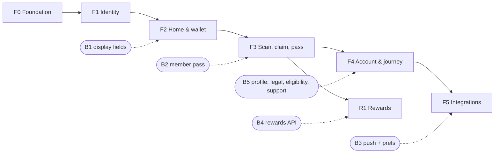

| Phase | Goal | Screens (§5.1) | Endpoints | Backend blockers (§16) |
|---|---|---|---|---|
| F0 | Wired, tested skeleton: dev/prod flavours (§3.2), theme, `core/ui`, `ApiClient`, wallet slice (§3.1) | shell, Home balance | LO-01 | — |
| F1 | Sign-in, restore, sign-out | welcome, phone_entry, otp_verify, eligibility_gate | ID-01–05, ID-11 | B5 (ID-10, ID-12) |
| F2 | All read-only screens | home, activity, transaction_details, account_home, personal_details, points_and_rewards | LO-01, LO-02, CL-09, ID-05 | B1, B5 (ID-06) |
| F3 | The purchase journey on physical devices | scan, claim_review, claim_pass, claim_status | CL-01–04 | B2 (optional) |
| F4 | Remaining screens, accessibility, journey test, release build | terms_and_privacy, logout_confirm, notification_settings | ID-04 | B3, B5 (ID-09, OP-04/05) |
| F5 | Sentry, push, analytics (each gated) | notification_settings (enabled) | ID-13–16 | B3 |
| R1 | Rewards and redemption | batches 8–11 | RE-01–07 | B4 (D-06) |

**App phases never wait on the backend:** each ships with the fallback in §16.2, and the work is done in vertical slices (domain → infra → use case → controller → screen → tests).

## 14. Open questions

| Question | Changes |
|---|---|
| Minimum Android and iOS versions | `mobile_scanner` and secure-storage configuration |
| Languages: English only, or English + Swahili for the MVP? | Whether F2 sets up ARB files now |
| Should the virtual pass be a standalone member pass, or only the per-claim credential? | A new backend endpoint vs. the current CL-03 |
| Push provider account (FCM) and analytics consent policy | F5 timing |
| Store distribution (internal testing track or TestFlight) for the pilot | Release pipeline (not planned here) |

## 15. Sources

- **App documents:** [README.md](README.md) (order of implementation), [PRD.md](PRD.md) (requirements AR-01–14), [ROADMAP.md](ROADMAP.md) (phases and gates AG1–AG3), [DELIVERY_PLAN.md](DELIVERY_PLAN.md), [PROGRESS.md](PROGRESS.md), [AGENTS.md](AGENTS.md).
- **Backend API reference** (generated from real traffic): [customer-app.md](../katakiu-backend/docs/api/reference/customer-app.md), [authentication.md](../katakiu-backend/docs/api/reference/authentication.md), [conventions.md](../katakiu-backend/docs/api/reference/conventions.md), [errors.md](../katakiu-backend/docs/api/reference/errors.md).
- **Business invariants:** [AGENTS.md](../katakiu-backend/AGENTS.md) §3.
- **Designs:** `katakiu_mobile_ui_production/` (each batch has `code.html` and `screen.png`), plus [DESIGN.md](katakiu_mobile_ui_production/mobile_loyalty_verification/DESIGN.md).
- **External docs:** [Riverpod code generation](https://riverpod.dev/docs/concepts/about_code_generation), [flutter_secure_storage](https://pub.dev/packages/flutter_secure_storage), [Flutter app size](https://docs.flutter.dev/perf/app-size).

## 16. Backend endpoints: done and missing

Statuses were checked against `katakiu-backend/api/endpoint-catalog.json` on 29 October 2026.

### 16.1 Done (live)

| ID | Endpoint | Used by |
|---|---|---|
| ID-01 | `POST /api/v1/auth/otp/request` | Phone entry, OTP resend |
| ID-02 | `POST /api/v1/auth/otp/verify` | OTP verify |
| ID-03 | `POST /api/v1/auth/refresh` | `ApiClient` (no screen) |
| ID-04 | `POST /api/v1/auth/logout` | Log out |
| ID-05 | `GET /api/v1/me` | Home, Account home, Personal details, Pass header |
| ID-11 | `GET /api/v1/me/eligibility` | Eligibility gate |
| CL-01 | `POST /api/v1/claims` | Scan |
| CL-02 | `GET /api/v1/claims/{claim_id}` | Claim pass (polling), Claim status |
| CL-03 | `POST /api/v1/claims/{claim_id}/tokens` | Claim pass |
| CL-04 | `POST /api/v1/claims/{claim_id}/cancel` | Claim review, Claim pass |
| CL-09 | `GET /api/v1/me/claims` | Home (pending claim), Transaction details |
| LO-01 | `GET /api/v1/me/wallet` | Home, Account home, Activity |
| LO-02 | `GET /api/v1/me/points` | Home, Activity, Points and rewards |

### 16.2 Catalogued but planned (backend must implement)

| ID | Endpoint | Needed by | Blocked by | MVP fallback in the app |
|---|---|---|---|---|
| ID-06 | `PATCH /api/v1/me` | Personal details → Edit details | — | Hide "Edit details" |
| ID-09 | `GET /api/v1/legal-documents` | Terms and privacy | Legal texts | Static pages via `url_launcher` |
| ID-10 | `POST /api/v1/me/consents` | Onboarding step 4 | Legal texts | Skip the step; pilot needs it |
| ID-12 | `POST /api/v1/me/eligibility` | Onboarding step 3 | D-02 eligibility method | Show the ID-11 result plus an explainer |
| ID-13 / ID-14 | `GET` / `PATCH /api/v1/me/notification-preferences` | Notification settings | Push (ID-15) | Row disabled |
| ID-15 / ID-16 | `POST /api/v1/me/devices`, `DELETE /api/v1/me/devices/{device_id}` | Push registration (F5) | FCM account | Polling on the pass screen |
| RE-01 / RE-02 | `GET /api/v1/rewards`, `GET /api/v1/rewards/{reward_id}` | Rewards list and detail (batch 8) | D-06 reward catalogue | Rewards tab hidden |
| RE-03 / RE-04 / RE-05 / RE-06 | `POST /api/v1/redemptions`, `GET /api/v1/redemptions/{id}`, `POST /api/v1/redemptions/{id}/tokens`, `POST /api/v1/redemptions/{id}/cancel` | Redemption (batches 9–11) | D-06 | Not built |
| RE-07 | `GET /api/v1/me/redemptions` | Points and rewards → Rewards tab; Activity → Redeemed | D-06 | Tab hidden |
| OP-04 / OP-05 | `POST` / `GET /api/v1/support/cases` | Report a concern, Contact support | — | `mailto:` / phone link |

The catalogue also lists ID-07/08 (session list and revoke). No design uses them, so the app does not plan for them.

### 16.3 Not catalogued: new backend work

These items must be agreed, then added to `api/endpoint-catalog.json` and the module contract, before either side builds them. That is the backend's AGENTS.md rule; they are proposals, not decisions.

| # | Need | Seen on | Proposal | Decision needed |
|---|---|---|---|---|
| N-1 | **Standalone member pass**: a refreshing member QR without an open claim | Home "Show my pass", Virtual pass (batch 2) | `POST /api/v1/me/pass-tokens` returning `credential`, `expires_at`. The merchant side needs a matching resolve, because CL-05 only resolves claim credentials | Does a member pass exist in the purchase-proof model, or does "Show my pass" always mean the current claim? |
| N-2 | **Merchant/outlet name and location** on statement entries and claims | Activity rows, Transaction details, Home recent activity, Claim review "Outlet" | Add `outlet: {name, region}` to LO-02 items and CL-02/CL-09 (null until confirmed) | Which outlet fields may a customer see? |
| N-3 | **Product name on statement entries** | Activity rows, Transaction details | Add `product: {name}` to LO-02 items (from the purchase) | — |
| N-4 | **`confirmed_at`** on claims | Claim status, Transaction details (date/time) | Add it to CL-02/CL-09 | — |
| N-5 | **Balance after transaction** | Transaction details | Add `balance_after` to LO-02 items, or drop the row from the design | Whether to expose running balances (statement IDs already raise a volume concern) |
| N-6 | **Single entry read** (optional) | Deep link to Transaction details | `GET /api/v1/me/points/{entry_id}`. Unneeded if N-2/N-3 enrich LO-02 and the app reads entries from the loaded page | Only if deep links or push need it |

**Until N-2 to N-5 land,** Transaction details shows only what the live responses contain: points, date, claim ref and product (via CL-09). Merchant, location and balance-after rows are hidden; the app never fills them with placeholders. This work is backend track **B1** in [DELIVERY_PLAN.md §5](DELIVERY_PLAN.md#5-backend-blockers).
