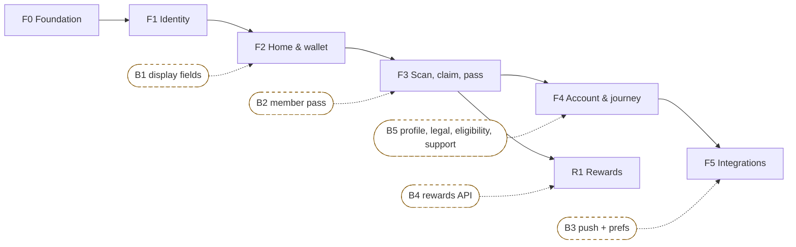

# KataKiu customer app: delivery plan

> **Status:** not started. **Progress:** 0 / 109 tasks done. Created 29 October 2026.
> **Design reference:** [ARCHITECTURE_PLAN.md](ARCHITECTURE_PLAN.md) (`§n` below refers to its sections).
> **Evidence log:** [PROGRESS.md](PROGRESS.md).
> **Requirements:** [PRD.md](PRD.md) (AR-01–14) · **Schedule and gates:** [ROADMAP.md](ROADMAP.md) (AG1–AG3) · **Agent rules:** [AGENTS.md](AGENTS.md)
> **Backend:** [katakiu-backend](../katakiu-backend/README.md). Backend work is tracked there, not here (§5).

## Contents

1. [How to use this file](#1-how-to-use-this-file)
2. [Phase map](#2-phase-map)
3. [Definition of done (every task)](#3-definition-of-done-every-task)
4. Phases: [F0 Foundation](#f0-foundation) · [F1 Identity](#f1-identity) · [F2 Home and wallet](#f2-home-and-wallet) · [F3 Scan, claim, pass](#f3-scan-claim-pass) · [F4 Account, settings, journey test](#f4-account-settings-journey-test) · [F5 Integrations](#f5-integrations) · [R1 Rewards](#r1-rewards)
5. [Backend blockers](#5-backend-blockers)
6. [Open questions and decisions log](#6-open-questions-and-decisions-log)
7. [Change log](#7-change-log)

---

## 1. How to use this file

**Task format.** Each task line has five parts:

`- [ ] F3-T09 [presentation] passController: CL-03 credential, countdown … (§6.2) — *done:* <evidence>`

| Part | Meaning |
|---|---|
| `F3-T09` | Unique ID. Use it in branch names, commits and PR titles, e.g. `feat(claims): F3-T09 pass countdown` |
| `[layer]` | `setup`, `core`, `ui`, `domain`, `infra`, `app` (use cases), `presentation`, `test`, `manual`, `ci` |
| text | What to build, with a reference to the design section |
| *done:* | The evidence required before ticking |

**Working rules:**
- **Ticking.** Change `[ ]` to `[x]` only when the *done* evidence exists: a passing test name, a command result, or a device-run note. Record that evidence in [PROGRESS.md](PROGRESS.md) in the same change.
- **Phase status.** Each phase heading carries a status: `not started` → `in progress` → `done`. A phase is done only when every task and its **exit** criteria are met.
- **Progress count.** Update the count in the header when ticking.
- **Order inside a phase:** setup → domain → infra → app → presentation → tests → manual. This is the vertical-slice order from §3.1.
- **Order between phases.** Phases run in order. F5 parts and R1 start only when their blocker clears.
- **Branching.** Use one branch and PR per phase, or per screen for large phases (F2, F3).
- **Blocked tasks.** A blocked task keeps `[ ]` and gets `**blocked by Bn**`. Never tick a task by stubbing out its dependency.

## 2. Phase map

Dashed nodes are backend work. App phases never wait for them: each ships with the fallback in §5.

| Phase | Goal | Requirements | Screens | Endpoints | Tasks |
|---|---|---|---|---|---|
| F0 | Wired, tested skeleton with dev/prod flavours plus one real slice | AR-02, AR-05 | Placeholder shell, Home balance | LO-01 | 45 |
| F1 | Sign-in, restore, sign-out | AR-01–03 | welcome, phone_entry, otp_verify, eligibility_gate | ID-01–05, ID-11 | 15 |
| F2 | All read-only screens | AR-04–06, AR-10 | home, activity, transaction_details, account_home, personal_details, points_and_rewards | LO-01, LO-02, CL-09, ID-05 | 15 |
| F3 | The purchase journey | AR-07–11 | scan, claim_review, claim_pass, claim_status | CL-01–04 | 16 |
| F4 | Remaining screens, a11y, journey test, release build | AR-02, AR-12 | terms_and_privacy, logout_confirm, notification_settings | ID-04 | 9 |
| F5 | Monitoring, push, analytics | AR-13 | notification_settings (enabled) | ID-13–16 | 6 |
| R1 | Rewards and redemption | AR-14 | rewards_list, reward_detail, redemption, redemption_result | RE-01–07 | 3 |

## 3. Definition of done (every task)

A task is done only when **all** of these hold for the code it touches:

- [ ] `dart format --set-exit-if-changed .` is clean and `flutter analyze` reports 0 issues.
- [ ] The tests for the touched code pass (`flutter test`).
- [ ] The domain layer imports nothing from `flutter`, `riverpod`, `http` or Firebase (§1).
- [ ] No product code, pass credential, OTP, token or phone number reaches a log, crash report or analytics event (§9).
- [ ] Every state of a touched screen listed in §5.1 has a widget test.
- [ ] User-facing strings come from the single strings file, with no inline literals in widgets.
- [ ] No mock, fake or placeholder data is reachable in a release build.
- [ ] Mutations disable their trigger while in flight, and retries reuse the same `Idempotency-Key` (§6.2).
- [ ] No raw colours, font sizes, paddings or radii outside `lib/core/theme/` (`no_raw_styles_test` passes; ARCHITECTURE_PLAN §10.5).
- [ ] Works in **both flavours**. Flavour checks live only in `app/config.dart` and the providers, never in domain or application code (§3.2).

---

## F0 Foundation

**Status:** not started · **Depends on:** nothing · **Requirements:** AR-02 (client), AR-05 · **Endpoints:** LO-01 (wallet slice)

**Setup**
- [ ] F0-T01 [setup] If `katakiu-app` is not yet a git repository, run `git init` first. Then `flutter create --org com.katakiu --platforms android,ios katakiu_app` and commit the scaffold. Keep the existing planning `README.md`: do not let the generated template overwrite it, and merge any useful generated lines into it — *done:* `flutter run` shows the counter app on an emulator.
- [ ] F0-T02 [setup] `analysis_options.yaml`: `flutter_lints` plus `strict-casts`, `strict-inference` and `strict-raw-types` — *done:* `flutter analyze` is clean.
- [ ] F0-T03 [setup] Create only the folders F0 needs: `app/`, `core/{network,security,observability,ui}` and `features/wallet/{domain,infrastructure,application,presentation}` (§3) — *done:* the tree matches §3.
- [ ] F0-T04 [setup] `flutter pub add flutter_riverpod http go_router uuid` and `flutter pub add --dev flutter_launcher_icons flutter_native_splash` — *done:* resolved versions recorded in PROGRESS.md.
- [ ] F0-T05 [setup] Bundle Inter 400/500/600/700 in `assets/fonts/` and declare it in `pubspec.yaml` (§10) — *done:* the text renders in Inter with no network.
- [ ] F0-T06 [setup] App icon and splash screen from `katakiu_mobile_ui_production/katakiu_logo.png`, **per flavour**: the dev icon and splash carry a "DEV" badge (`flutter_launcher_icons-dev.yaml` / `-prod.yaml`, the same for splash; ARCHITECTURE_PLAN §3.2) — *done:* both flavours show the correct icon on Android and iOS.
- [ ] F0-T07 [setup] `app/config.dart` reads `FLAVOR`, `API_BASE_URL`, `SENTRY_DSN` and `POSTHOG_KEY` from `--dart-define-from-file=config/<flavour>.json` and fails fast when they are missing. The README documents the base URLs for dev:
  - Android emulator: `http://10.0.2.2:8080`
  - iOS simulator: `http://localhost:8080`
  - physical device: your LAN IP, in a git-ignored `config/dev.local.json`

  *Done:* the app refuses to start without a config file.
- [ ] F0-T08 [setup] Allow cleartext HTTP to the local backend **in the dev flavour only**: `android/app/src/dev/AndroidManifest.xml` `usesCleartextTraffic="true"`, and the iOS ATS exception in the `*-dev` configurations only — *done:* the prod manifest and prod configurations contain no cleartext or ATS exception (checked in the merged manifest and build settings).
- [ ] F0-T08a [setup] Change the base `applicationId` (and the iOS base bundle ID) from the generated `com.katakiu.katakiu_app` to `com.katakiu.app` (Q8). Then add Android `productFlavors` (`env` dimension): `dev` with `applicationIdSuffix ".dev"` and `app_name` "KataKiu Dev"; `prod` with "KataKiu"; the `src/dev/` and `src/prod/` source sets; `android:label="@string/app_name"` (§3.2) — *done:* dev and prod APKs install side by side on one device with the correct names.
- [ ] F0-T08b [setup] iOS build configurations `Debug/Profile/Release-dev` and `-prod`, the shared `dev` and `prod` schemes, and per-configuration `PRODUCT_BUNDLE_IDENTIFIER` and `APP_DISPLAY_NAME` (read by `Info.plist`) — *done:* `flutter run --flavor dev` and `--flavor prod` both launch on the simulator, side by side.
- [ ] F0-T08c [setup] `config/dev.json` and `config/prod.json` with public values only (`FLAVOR`, `API_BASE_URL`); `.gitignore` excludes `config/*.local.json` — *done:* `git grep -iE 'dsn|key|secret' config/` shows no secret values.
- [ ] F0-T08d [core] `AppConfig` validation: `appFlavor` (confirm it is available in the installed SDK, and record that in PROGRESS.md) must equal the config's `FLAVOR`; an unknown or missing flavour fails; prod needs an `https` base URL; logging is verbose in dev and warnings-only in prod — *done:* unit tests for each mismatch and the prod http rejection.
- [ ] F0-T08e [setup] `.vscode/launch.json` with "KataKiu dev" and "KataKiu prod" entries, plus README commands to run and build (apk, appbundle, ipa) for each flavour (ARCHITECTURE_PLAN §3.2 command table) — *done:* both entries launch.

**Core**
- [ ] F0-T09 [core] `ApiFailure` sealed hierarchy: `Unauthenticated`, `RateLimited(retryAfter)`, `UnknownOutcome`, `NetworkUnavailable`, `ApiError(status, code, message, fieldErrors)` (§3.1) — *done:* exhaustive `switch` compiles.
- [ ] F0-T10 [core] `ApiClient.get/post`: base URL, JSON, envelope unwrap to `data`, a UUID `X-Request-ID` on every request, an `idempotencyKey` parameter and connect/receive timeouts — *done:* unit tests in F0-T23.
- [ ] F0-T11 [core] `ApiClient` 401 handling: an injected `refresh()` callback, single-flight (concurrent 401s await one refresh), retrying the original request once — *done:* F0-T23 concurrency test.
- [ ] F0-T12 [core] `ApiClient` error mapping:
  - 429 + `Retry-After` → `RateLimited`;
  - a POST timeout → `UnknownOutcome`;
  - a GET timeout or socket error → `NetworkUnavailable`;
  - other non-2xx → `ApiError` from the envelope.

  *Done:* F0-T23.
- [ ] F0-T13 [core] `core/observability/log.dart`: a redacting logger. Keys matching `code|credential|otp|token|authorization|phone` print as `<redacted>` — *done:* F0-T24.
- [ ] F0-T14 [core] `SessionStore` interface plus an `InMemorySessionStore` (the secure store comes in F1-T03) — *done:* used by `ApiClient` in tests.

**UI foundation**
- [ ] F0-T15a [ui] Token constants in `lib/core/theme/`: `kk_colors`, `kk_typography`, `kk_spacing`, `kk_radius`, `kk_sizes`, `kk_shadows`, with every value from ARCHITECTURE_PLAN §10.3 — *done:* a unit test asserts the key tokens (teal, tealText, coralText, midnight, divider, the balance style, the space scale, radii 6/8/12, button height 48).
- [ ] F0-T15b [ui] `KkStatusColors` ThemeExtension (confirmed, pending, rejected, neutral) and `theme_context.dart` (`context.kk`) — *done:* a widget test reads each set from a themed context.
- [ ] F0-T15c [ui] `KkTheme.light()`: an explicit `ColorScheme` plus every component theme in §10.4, and `KkButtonStyles` (scan, destructive, destructiveFilled) — *done:* a widget test checks button height 48 and radius 8, a card with elevation 0 and a 1 px divider border, and the input focus border in teal; the gallery screenshot is in PROGRESS.md.
- [ ] F0-T15d [test] `test/theme/no_raw_styles_test.dart` scans `lib/` (excluding `core/theme/`) for `Color(0x`, `Colors.` (except `transparent`), `fontSize:` and literal `BorderRadius.circular(` — *done:* it fails on a deliberately added raw colour and passes once it is removed.
- [ ] F0-T15e [ui] Contrast review of the token pairs in §10.7, with note (a), white on teal buttons, raised with the designer (Q9) — *done:* the decision or open status is recorded in §6 and PROGRESS.md.
- [ ] F0-T16 [ui] `core/ui/format.dart`: `formatPoints(Points)` ("1,840 PTS", signed variant "+240 PTS"), plus UTC → local date and time formatters — *done:* unit tests, including `BigInt` values above 2^53.
- [ ] F0-T17a [ui] `KkAppBar`: back, title, optional trailing action — *done:* widget test.
- [ ] F0-T17b [ui] `KkBottomNav`: Home, Scan, Account; active tab in teal; pending dot on Scan — *done:* widget test.
- [ ] F0-T17c [ui] `PointsBalanceCard`: available, pending chip, "Last updated" (offline), zero balance, loading — *done:* widget test per variant.
- [ ] F0-T17d [ui] `StatusChip`: confirmed, pending, redeemed, reversed, verified, offline, expired — *done:* widget test.
- [ ] F0-T17e [ui] `ActivityRow`: title, place · time, signed points colour, optional chip — *done:* widget test.
- [ ] F0-T17f [ui] `InfoBanner`: info, success, pending, lock, warning, error — *done:* widget test.
- [ ] F0-T17g [ui] `KeyValueList`: rows with dividers, monospace value variant — *done:* widget test.
- [ ] F0-T17h [ui] `buttons.dart`: `PrimaryButton`, `SecondaryButton`, `DestructiveButton`, each with loading and disabled states — *done:* a loading button ignores taps (widget test).
- [ ] F0-T17i [ui] `ResultScreenScaffold`: icon, headline, body, optional details card, two actions — *done:* widget test.
- [ ] F0-T17j [ui] `SegmentedTabs` — *done:* widget test.
- [ ] F0-T17k [ui] `NavListTile`: enabled and disabled variants — *done:* widget test.
- [ ] F0-T18 [ui] `routerProvider`: a `StatefulShellRoute.indexedStack` with Home, Scan and Account placeholders, plus a redirect stub (§3.1 step 6) — *done:* tabs keep their own stack (manual check).
- [ ] F0-T19 [ui] A component gallery route registered only when `kDebugMode` — *done:* screenshot in PROGRESS.md; the route is absent from release builds of both flavours.

**Wallet slice (proves the pattern, §3.1)**
- [ ] F0-T20 [domain] `Points` (BigInt, `parse`) and `Wallet` (available, pending) — *done:* tests for parse, large values and invalid input.
- [ ] F0-T21 [infra] `HttpWalletRepository.fetch()` calling LO-01 `GET /me/wallet` — *done:* DTO test using the captured LO-01 payload from [customer-app.md](../katakiu-backend/docs/api/reference/customer-app.md).
- [ ] F0-T22 [app/presentation] `GetWallet`, `walletProvider`, and the Home placeholder showing `PointsBalanceCard`. The access token comes from a **debug-only** `--dart-define=DEV_ACCESS_TOKEN` until F1, and that code path is deleted in F1-T06 — *done:* the seeded customer's balance is visible on an emulator.

**Tests and tooling**
- [ ] F0-T23 [test] `ApiClient` tests using `http` `MockClient`:
  - envelope success and error;
  - `VALIDATION_FAILED` `fieldErrors`;
  - 401 → refresh → retry once;
  - two concurrent 401s → one refresh;
  - refresh failure → `Unauthenticated`;
  - POST timeout → `UnknownOutcome`;
  - 429 → `RateLimited(50 s)`;
  - `X-Request-ID` present.

  *Done:* all pass.
- [ ] F0-T24 [test] Logger redaction test — *done:* a token, an OTP and a product code are absent from the captured output.
- [ ] F0-T25 [ci] GitHub Actions workflow running `dart format --set-exit-if-changed`, `flutter analyze` and `flutter test`, plus a build matrix: `flutter build apk --flavor dev --dart-define-from-file=config/dev.json` and the same for `prod` — *done:* green on the first PR, with both flavours built.
- [ ] F0-T26 [setup] Create [PROGRESS.md](PROGRESS.md) entries for F0 (environment, pinned versions, commands) — *done:* the F0 session is logged.

**F0 exit:** boots on an Android emulator and an iOS simulator · `flutter analyze` is clean · CI is green · Home shows the seeded wallet balance.

---

## F1 Identity

**Status:** not started · **Depends on:** F0 · **Requirements:** AR-01, AR-02, AR-03 · **Endpoints:** ID-01, ID-02, ID-03, ID-04, ID-05, ID-11 · **Screens:** welcome, phone_entry, otp_verify, eligibility_gate

- [ ] F1-T01 [setup] `flutter pub add flutter_secure_storage`. Android `encryptedSharedPreferences: true`; iOS Keychain accessibility `first_unlock_this_device` — *done:* the configuration is reviewed in the PR.
- [ ] F1-T02 [domain] `PhoneNumber` (normalises `07…`, `7…`, `+2547…` and `+2541…` to E.164; rejects anything else), `Session`, `Profile`, `EligibilityResult` — *done:* phone normalisation table test.
- [ ] F1-T03 [infra] `SecureSessionStore`, which persists **only** the refresh token. The access token stays in memory — *done:* test with an in-memory secure-storage fake.
- [ ] F1-T04 [infra] `HttpIdentityRepository`:
  - `requestOtp` (ID-01, `purpose: sign_in`, `client_type: customer_app`);
  - `verifyOtp` (ID-02);
  - `refresh` (ID-03);
  - `logout` (ID-04);
  - `profile` (ID-05);
  - `eligibility` (ID-11).

  *Done:* DTO tests against the captured ID-01/02/05/11 payloads.
- [ ] F1-T05 [app] Use cases: `RequestOtp`, `VerifyOtp`, `RefreshSession`, `Logout`, `GetProfile`, `GetEligibility` — *done:* unit tests with fake repositories.
- [ ] F1-T06 [presentation] `sessionController`:
  - restore on start (refresh token → ID-03);
  - sign-in;
  - sign-out;
  - session lost (`REFRESH_REUSED`/`SESSION_REVOKED`).

  It wires `RefreshSession` into the `ApiClient` refresh hook and deletes the F0 `DEV_ACCESS_TOKEN` path. *Done:* F1-T14 tests; `grep DEV_ACCESS_TOKEN` returns nothing.
- [ ] F1-T07 [presentation] Router redirect: no session goes to `/welcome`; a session blocks `/welcome` and `/sign-in/*` and redirects to `/home` — *done:* router test.
- [ ] F1-T08 [presentation] Screen `welcome/` (batch 1): Create account and "I already have an account" both lead to phone entry — *done:* widget test.
- [ ] F1-T09 [presentation] Screen `phone_entry/` + `widgets/kenya_phone_field.dart`. States: idle, invalid, submitting, `RATE_LIMITED` (Continue disabled for `retry_after_seconds`) — *done:* widget test per state.
- [ ] F1-T10 [presentation] Screen `otp_verify/` + `otp_controller.dart` + `widgets/otp_boxes.dart`, `resend_countdown.dart`. Includes `AutofillHints.oneTimeCode` and auto-submit on the 6th digit. States: `OTP_INVALID`, expired challenge, resend available, rate-limited — *done:* widget test per state.
- [ ] F1-T11 [presentation] `identity/presentation/widgets/step_header.dart` ("STEP n OF 4") — *done:* used by F1-T09 and F1-T10.
- [ ] F1-T12 [presentation] Screen `eligibility_gate/`, reading ID-11. States:
  - approved → `/home`;
  - not checked (404) → explainer;
  - rejected;
  - expired.

  Submission is shown as "coming soon" (**blocked by B5**: ID-12, ID-10). *Done:* widget test per state.
- [ ] F1-T13 [presentation] One account-scoped invalidation list in `sessionController`, used on logout and session loss (§7) — *done:* test showing the profile and wallet providers re-fetch for the next user.
- [ ] F1-T14 [test] `sessionController` tests: restore succeeds, restore fails → `/welcome`, sign-in stores the refresh token, `REFRESH_REUSED` → signed out and store cleared, logout clears the store even when ID-04 fails — *done:* all pass.
- [ ] F1-T15 [manual] **Dev flavour, against the seeded backend:** sign in with a seeded customer from [TEST_ACCOUNTS.md](../katakiu-backend/docs/TEST_ACCOUNTS.md) (dev OTP fixture), kill and relaunch the app (still signed in), then sign out. Do this on both platforms — *done:* noted in PROGRESS.md.

**F1 exit:** the sign-in → restore → sign-out cycle works on Android and iOS; there is no dev-token code left.

---

## F2 Home and wallet

**Status:** not started · **Depends on:** F1 · **Requirements:** AR-04, AR-05, AR-06, AR-10 · **Endpoints:** LO-01, LO-02, CL-09, ID-05 · **Screens:** home, activity, transaction_details, account_home, personal_details, points_and_rewards

- [ ] F2-T01 [setup] `flutter pub add intl` and add the `flutter_localizations` SDK dependency. Set the locale to `en_KE` — *done:* `formatPoints` and dates use the locale (test).
- [ ] F2-T02 [domain] `StatementEntry` (id, bucket, delta, kind, purchaseId, createdAt), `Page<T>` (items, nextCursor, hasMore), `ClaimSummary` — *done:* unit tests.
- [ ] F2-T03 [infra] `HttpWalletRepository.listStatement(kind?, cursor?, limit)` (LO-02) and `HttpClaimRepository.listHistory(cursor?, limit)` (CL-09) — *done:* DTO tests against the captured LO-02 and CL-09 payloads.
- [ ] F2-T04 [app] `ListStatement`, `ListClaimHistory` — *done:* unit tests.
- [ ] F2-T05 [presentation] Providers:
  - `profileProvider`;
  - `statementProvider(kind)`: paginated; `VALIDATION_FAILED` on a stale cursor restarts from page 1;
  - `claimHistoryProvider`;
  - `transactionProvider(entryId)`.

  *Done:* provider tests.
- [ ] F2-T06 [presentation] Screen `home/` + `widgets/greeting_header`, `first_purchase_card`, `how_earning_works`, `pending_verification_banner` (test boards). States: returning user, first-time (0 PTS), pending claim — *done:* widget test per state.
- [ ] F2-T07 [presentation] Pull-to-refresh on Home, Activity and Account invalidates that screen's providers (§6.0) — *done:* widget test.
- [ ] F2-T08 [presentation] Screen `activity/` + `statement_controller` + `widgets/activity_list`, `activity_empty_state` (batch 3). Tabs:
  - All: no filter;
  - Earned: `kind=purchase_award`;
  - Redeemed: hidden until R1.

  *Done:* widget tests for list, empty, loading-more and error.
- [ ] F2-T09 [presentation] Screen `transaction_details/` + `widgets/transaction_hero.dart`, using the interim LO-02 + CL-09 join on `purchase_id`. Merchant, location and balance-after rows are hidden (**blocked by B1**) — *done:* widget tests for confirmed and reversed, with no placeholder values.
- [ ] F2-T10 [presentation] Screen `account_home/` + `widgets/profile_card`, `responsible_note` (batch 12) — *done:* widget test.
- [ ] F2-T11 [presentation] Screen `personal_details/`, read-only from ID-05. "Edit details" is hidden (**blocked by B5**: ID-06) — *done:* widget test.
- [ ] F2-T12 [presentation] Screen `points_and_rewards/`, Points tab only. The Rewards tab is hidden until R1 — *done:* widget test.
- [ ] F2-T13 [presentation] Offline reads: keep the last fetched wallet and statement in memory and show "Last updated …" (§8) — *done:* widget test with `NetworkUnavailable`.
- [ ] F2-T14 [test] Pagination to `has_more=false`, the stale-cursor restart, first-time Home, and one wallet fetch serving both Home and Account (call count) — *done:* all pass.
- [ ] F2-T15 [manual] **Dev flavour:** balances and statement entries match the seed for two seeded customers (one with activity, one with zero points) — *done:* noted in PROGRESS.md.

**F2 exit:** every read-only screen works against the seed, with no placeholder data.

---

## F3 Scan, claim, pass

**Status:** not started · **Depends on:** F2 · **Requirements:** AR-07, AR-08, AR-09, AR-10, AR-11 · **Gate:** AG1 follows · **Endpoints:** CL-01, CL-02, CL-03, CL-04 · **Screens:** scan, claim_review, claim_pass, claim_status

- [ ] F3-T01 [setup] `flutter pub add mobile_scanner qr_flutter wakelock_plus screen_brightness`. Add camera permission text: iOS `NSCameraUsageDescription`; Android camera permission — *done:* the permission prompt shows on both platforms.
- [ ] F3-T02 [domain]
  - `ProductCode`: in memory only; `toString()` redacted; never serialised;
  - `Claim`, `ClaimStatus` and the claim state machine (§6.3);
  - `PassCredential` (credential, expiresAt).

  *Done:* transition table tests.
- [ ] F3-T03 [infra] `HttpClaimRepository`:
  - `open` (CL-01 + key, `product_code` and `code_format` in the body only);
  - `issueToken` (CL-03 + key);
  - `read` (CL-02);
  - `cancel` (CL-04 + key).

  *Done:* DTO tests against the captured CL-01–04 payloads.
- [ ] F3-T04 [app] `OpenClaim`, `IssuePassCredential`, `RefreshClaim`, `CancelClaim` — *done:* unit tests.
- [ ] F3-T05 [presentation] `scanController`:
  - `MobileScannerController(formats: [BarcodeFormat.qrCode])`;
  - pause on the first detection;
  - single in-flight submit;
  - a new `Idempotency-Key` per logical attempt, reused on retry;
  - drop the code after CL-01 returns.

  *Done:* controller tests (duplicate detection ignored, key reuse on retry).
- [ ] F3-T06 [presentation] Screen `scan/` + `widgets/scanner_frame`, `manual_code_field` (paste, `code_format: manual`), `how_it_works_list`, `camera_permission_notice` (batch 4) — *done:* widget tests for camera, manual, permission-denied and submitting.
- [ ] F3-T07 [presentation] Screen `claim_review/` + `widgets/claim_summary_card.dart` (batch 5). Continue goes to the pass; Cancel claim runs CL-04 → status — *done:* widget test, including `STATE_CONFLICT` → re-read.
- [ ] F3-T08 [presentation] `claimController(id)`: polls CL-02 every 3 s (proposed value, configurable) while the pass is visible and stops in `ref.onDispose`. On `confirmed`, it invalidates `walletProvider`, `statementProvider` and `claimHistoryProvider` — *done:* fake-clock test (polling stops, invalidation happens).
- [ ] F3-T09 [presentation] `passController(id)`:
  - CL-03 credential with a countdown to `expires_at`;
  - expired state → Refresh pass issues a new credential under a new key;
  - `wakelock_plus` on and brightness up while visible;
  - both restored on dispose and when the app goes to the background.

  *Done:* controller test plus a lifecycle test.
- [ ] F3-T10 [presentation] Screen `claim_pass/` + `widgets/pass_header`, `pass_qr` (`qr_flutter`), `expiry_countdown` (batches 5 and 2). States: active, refreshing, expired, offline ("Live pass unavailable") — *done:* widget test per state.
- [ ] F3-T11 [presentation] Screen `claim_status/` + `widgets/code_details_card.dart` (batches 6 and 7) using `ResultScreenScaffold`. States:
  - confirmed;
  - already used (`CODE_ALREADY_SPENT`);
  - expired;
  - could not verify (`CODE_INVALID`);
  - not eligible (`BATCH_RECALLED`, `CAMPAIGN_NOT_ELIGIBLE`, `RULE_HOLD_UNSUPPORTED`);
  - eligibility required;
  - connection unavailable;
  - unknown / checking.

  *Done:* widget test per state.
- [ ] F3-T12 [presentation] Unknown outcome (§6.3): on `UnknownOutcome` from CL-01, replay with the **same** key and body. If that is impossible (for example, after an app restart), check the latest CL-09 claim. Meanwhile show "Checking securely — do not submit again" — *done:* test where a timeout leads to a replay that returns the original claim.
- [ ] F3-T13 [presentation] Home "Show my pass" opens the pending claim's pass, or Scan when there is none. A standalone member pass is **blocked by B2** — *done:* widget test for both cases.
- [ ] F3-T14 [test] Security and robustness:
  - a log capture during the whole scan → pass flow contains no product code and no credential;
  - a barcode-only frame never submits;
  - polling stops on dispose;
  - wakelock and brightness are restored.

  *Done:* all pass.
- [ ] F3-T15 [manual] **Physical Android, dev flavour:**
  1. Scan a seeded QR code.
  2. Confirm through the merchant PWA (or `curl` CL-05 then CL-06 with a seeded staff token).
  3. The pass flips to confirmed and the wallet updates.

  Also try the manual-entry path. *Done:* noted in PROGRESS.md with the device model.
- [ ] F3-T16 [manual] **Physical iOS, dev flavour:** the same as F3-T15. Then record `flutter build apk --flavor prod --dart-define-from-file=config/prod.json --analyze-size` and the iOS app size in PROGRESS.md — *done:* noted.

**F3 exit:** the purchase journey works end to end on physical Android and iOS; all claim states render.

---

## F4 Account, settings, journey test

**Status:** not started · **Depends on:** F3 · **Requirements:** AR-02, AR-12 · **Gate:** AG2 follows · **Endpoints:** ID-04 · **Screens:** terms_and_privacy, logout_confirm, notification_settings

- [ ] F4-T01 [setup] `flutter pub add url_launcher package_info_plus` — *done:* versions recorded in PROGRESS.md.
- [ ] F4-T02 [presentation] Screen `terms_and_privacy/` + `widgets/support_links.dart` (settings batch 2):
  - Terms, Privacy and Responsible participation open allow-listed KataKiu URLs;
  - Contact support uses `mailto:` or `tel:` (**blocked by B5**: OP-04/05; legal texts from ID-09).

  *Done:* a widget test showing a non-allow-listed URL is refused.
- [ ] F4-T03 [presentation] Screen `logout_confirm/`: Log out calls ID-04 and **always** clears local state and providers, even on failure; Cancel goes back — *done:* widget test plus a failure-path test.
- [ ] F4-T04 [presentation] Screen `notification_settings/`: a disabled row and a "coming soon" note (**blocked by B3**: ID-13/14) — *done:* widget test.
- [ ] F4-T05 [presentation] Show the app version (`package_info_plus`) on account home — *done:* widget test.
- [ ] F4-T06 [ui] Move every user-facing string into one strings file, ready for ARB once Swahili is confirmed (§14) — *done:* `grep` finds no inline literals in `presentation/`.
- [ ] F4-T07 [ui] Accessibility:
  - text scale 1.3× without overflow;
  - semantic labels on icon buttons, the QR and the status chips;
  - tap targets ≥ 48 dp;
  - contrast checked against DESIGN.md.

  *Done:* widget tests at 1.3× scale; notes in PROGRESS.md.
- [ ] F4-T08 [test] `integration_test` journey with `--flavor dev` against the seeded local backend (never prod): sign in → wallet → open a claim with a seeded code → pass → confirm via an HTTP helper acting as staff (CL-05/CL-06) → confirmed status → wallet updated → logout — *done:* passes on an emulator; the command is in PROGRESS.md.
- [ ] F4-T09 [ci] Release builds for **both flavours**: `flutter build appbundle|ipa --flavor dev|prod --dart-define-from-file=config/<flavour>.json --obfuscate --split-debug-info=build/symbols`. For prod, verify:
  - an `https` base URL;
  - no cleartext or ATS exception;
  - the gallery route is absent;
  - warnings-only logging;
  - no fakes reachable;
  - prod app ID and name.

  *Done:* both flavours' release builds run on both devices, and the prod checks are recorded in PROGRESS.md.

**F4 exit:** the journey test passes; release builds run on Android and iOS.

---

## F5 Integrations

**Status:** not started · **Requirements:** AR-13 · **Depends on:** F4 plus each prerequisite below. A task starts only once its prerequisite exists.

- [ ] F5-T01 [core] *(needs a Sentry DSN)* `sentry_flutter` with `SENTRY_DSN` injected by CI (never in `config/*.json`) and `environment` set from the flavour (`dev`/`prod`); `beforeSend` runs the redactor; no personal data — *done:* redaction test plus a test event visible in Sentry.
- [ ] F5-T02 [setup] *(needs an FCM project, an APNs key and **B3**)* add the per-flavour Firebase files (`android/app/src/{dev,prod}/google-services.json`, `ios/config/{dev,prod}/GoogleService-Info.plist` plus a copy build phase), `firebase_core` and `firebase_messaging` — *done:* a test push is received in both flavours, from their own Firebase projects.
- [ ] F5-T03 [infra/presentation] *(needs **B3**: ID-15/16)* register the device after sign-in (ID-15) and remove it on logout (ID-16) — *done:* integration test against the backend.
- [ ] F5-T04 [presentation] *(needs **B3**)* `flutter_local_notifications` for foreground messages. A "claim confirmed" push refreshes `claimController`, with polling kept as the fallback — *done:* manual test on both devices.
- [ ] F5-T05 [presentation] *(needs **B3**: ID-13/14)* enable the `notification_settings/` toggles (purchase confirmations always on; partner offers optional) — *done:* widget and integration tests.
- [ ] F5-T06 [core] *(needs consent rules)* `posthog_flutter` with an event allow-list, no personal data and no codes; disabled in dev (or a separate dev project) — *done:* test proving disallowed properties are dropped.

---

## R1 Rewards

**Status:** not started · **Requirements:** AR-14 · **Gate:** AG3 · **Depends on:** F3 + **B4** (D-06 reward catalogue, D-05 for reversals) · **Endpoints:** RE-01 to RE-07 · **Screens:** batches 8–11

These tasks are detailed once D-06 is decided. Until then they are placeholders.
- [ ] R1-T01 [domain/infra/app] Reward, Redemption and repository for RE-01 to RE-07 — *done:* DTO tests against the captured payloads.
- [ ] R1-T02 [presentation] Screens `rewards_list/`, `reward_detail/`, `redemption/` and `redemption_result/`. They reuse the F3 pass, countdown and unknown-outcome patterns (batch 11: "checking securely") — *done:* widget test per design state.
- [ ] R1-T03 [presentation] Show the Rewards tab on `points_and_rewards/` and the Redeemed tab on `activity/` — *done:* widget tests.

---

## 5. Backend blockers

This work is tracked in the backend repository: [DELIVERY_PLAN](../katakiu-backend/docs/implementation/DELIVERY_PLAN.md), [ENDPOINT_INDEX](../katakiu-backend/docs/implementation/ENDPOINT_INDEX.md). The details and proposals are in ARCHITECTURE_PLAN §16.

| ID | Backend work | Unblocks | App fallback until then | Decision needed |
|---|---|---|---|---|
| B1 | §16 N-2 to N-5: outlet name and region, product name, `confirmed_at` on LO-02 and CL-02/CL-09; decide on `balance_after` | F2-T09 full design | Rows hidden | Which outlet fields customers may see; running balance yes/no |
| B2 | §16 N-1: member pass credential and merchant resolve | F3-T13 standalone pass | Route to Scan / the pending claim's pass | Does a member pass fit the purchase-proof model? |
| B3 | ID-15/16 push devices, then ID-13/14 preferences | F4-T04, F5-T02 to F5-T05 | Polling; disabled row | FCM account |
| B4 | RE-01 to RE-07 and the point-movement model | R1 | Rewards and Redeemed tabs hidden | D-06, D-05 |
| B5 | ID-06 profile edit, ID-09 legal documents, ID-10 consent, ID-12 eligibility submission, OP-04/05 support | F1-T12, F2-T11, F4-T02 | Hidden, static or `mailto:` | Legal texts; D-02 eligibility method |

When a blocker clears, untick nothing. Add a follow-up task to the affected phase (for example `F2-T16 show outlet rows from B1`) and log it in §7.

## 6. Open questions and decisions log

| # | Question / decision | Affects | Status | Outcome |
|---|---|---|---|---|
| Q1 | Minimum Android and iOS versions | F0-T01, F3 scanner | open | |
| Q2 | Languages for the MVP: English only, or English + Swahili | F4-T06 | open | |
| Q3 | Standalone member pass, or per-claim pass only | B2, F3-T13 | open | |
| Q4 | Push provider (FCM) account and analytics consent policy | F5 | open | |
| Q5 | Polling interval for claim status (proposed 3 s) | F3-T08 | proposed | |
| Q6 | Store distribution for the pilot (internal track / TestFlight) | after F4 | open | |
| Q7 | Support channel for "Contact support" before OP-04/05 (email or phone) | F4-T02 | open | |
| Q8 | Final production app ID / bundle ID and store account owner (proposed `com.katakiu.app`, dev `com.katakiu.app.dev`) | F0-T08a/b | proposed | |
| Q9 | Designer confirms the theme notes in ARCHITECTURE_PLAN §10.7: (a) white labels on teal buttons fail AA (2.63:1), (b) destructive outline vs filled, (c) brand palette over the YAML M3 palette, (d) headline, nav and icon sizes | F0-T15e, AG2 | open | |

## 7. Change log

| Date | Change |
|---|---|
| 2026-10-29 | Created from ARCHITECTURE_PLAN §3.1, §5, §6.0, §11 and §16 |
| 2026-10-29 | Theme: F0-T15 split into F0-T15a–e (tokens, status colours, KkTheme, raw-style enforcement test, contrast review); new definition-of-done check; Q9 |
| 2026-10-29 | Linked to the new PRD.md (AR-01–14), ROADMAP.md (AG1–AG3) and AGENTS.md; a Requirements line on each phase and an AR column in the phase table |
| 2026-10-29 | Added dev/prod flavours: F0-T08a to F0-T08e; F0-T06/07/08/19/25, F4-T08/09 and F5-T01/02/06 updated; new definition-of-done check; Q8 |
