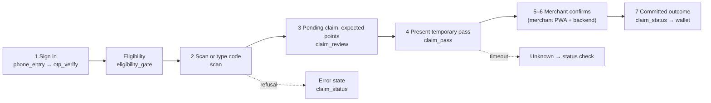

# KataKiu customer app: product requirements

> **Status:** plan, not implemented. Prepared 29 October 2026.
> **Governing document:** the backend [PRD](../katakiu-backend/PRD.md) is the source of truth for business requirements (FR-01–FR-18), product rules and decisions D-01–D-08. This file narrows it to the Flutter customer app and does not restate business rules.
> **Related documents:** [ROADMAP](ROADMAP.md) · [ARCHITECTURE_PLAN](ARCHITECTURE_PLAN.md) · [DELIVERY_PLAN](DELIVERY_PLAN.md) · [PROGRESS](PROGRESS.md) · [AGENTS](AGENTS.md)

## MVP first: keep it simple

This is an MVP. Build the simplest app that a customer can use end to end and a new developer can follow in one read:
- **Fewer, complete screens.** Ship screens that fully work against **live** endpoints rather than many screens on mock data.
- **Simple sign-in.** Phone OTP, a short-lived access token and a refresh token. No social login, biometrics or device binding until there is a real requirement.
- **Planned features stay hidden.** Use the documented fallback ([ARCHITECTURE_PLAN §16](ARCHITECTURE_PLAN.md#16-backend-endpoints-done-and-missing)); never half-build them.
- **Simple never weakens purchase proof.** The backend invariants still hold, and the app only displays server results.

## 1. Purpose and scope

The customer app lets an eligible customer:
- sign in;
- scan or type the concealed one-time code on a purchased product;
- present a temporary pass to an authorised merchant;
- see the confirmed points.

The backend is authoritative for eligibility, code use, claims and points (backend PRD [§1](../katakiu-backend/PRD.md#1-purpose-and-product-outcome) and [§4](../katakiu-backend/PRD.md#4-core-purchase-journey)).

**In scope:** the Flutter customer app for Android and iOS, in two flavours (dev and prod).

**Out of scope:** the merchant PWA, the admin portal and the backend itself (§9).

## 2. Users

| Actor | Needs in the app | Authority |
|---|---|---|
| Customer | Sign in, see eligibility, claim codes, present a pass, see points and history, manage settings, later redeem rewards | Own profile, claims, wallet, history and preferences only (backend PRD [§2](../katakiu-backend/PRD.md#2-users-and-responsibilities)) |

Staff and admins do not use this app. A person who is also staff uses the merchant PWA for outlet work. Personal points and outlet points stay separate.

## 3. Scope by stage

| Stage | App result | Backend alignment |
|---|---|---|
| **Prototype** (F0–F3) | Sign-in, balance, history, scan or manual claim, temporary pass, confirmation status and recovery, on dev against seeded data | Backend ROADMAP P-08 and gate G1 (customer part) |
| **Pilot MVP** (F4–F5) | Settings and legal pages, accessibility, release builds of both flavours, monitoring; push once B3 is done | Backend ROADMAP §4 "Customer app W5–W10" and gate G2 |
| **Rewards** (R1) | Rewards catalogue and redemption | Needs D-06 and backend RE-01–07 |
| **Conditional extensions** | Not built: USSD, cash rewards or payments, external age verification, live ride-voucher integration and the other items in backend PRD [§3](../katakiu-backend/PRD.md#3-scope-by-delivery-stage) | Each needs an explicit decision |

The designs illustrate some future states. Illustrating something does not put it in scope.

## 4. Customer journey (app view)

This is backend PRD §4 seen from the app. Screens are as listed in [ARCHITECTURE_PLAN §5.1](ARCHITECTURE_PLAN.md#51-screen-inventory-and-folders).

## 5. App requirements and acceptance criteria

Each requirement traces to a backend FR. The delivery tasks are in [DELIVERY_PLAN](DELIVERY_PLAN.md).

| ID | Requirement | Acceptance criteria | Source | Screens | Delivery |
|---|---|---|---|---|---|
| AR-01 | OTP sign-in | Kenyan numbers are normalised to E.164. An OTP is requested and verified. Wrong-code, expired-challenge and rate-limited states are shown, with the resend wait taken from the server's retry time. The app never hardcodes a test OTP | FR-01 | welcome, phone_entry, otp_verify | F1 |
| AR-02 | Session persistence, refresh and logout | Only the refresh token is stored, in secure storage. Concurrent 401s trigger a single refresh. Refresh reuse or revocation signs the customer out. Logout clears local state even when the server call fails, and the next user sees no residue | FR-01 | all; logout_confirm | F0, F1, F4 |
| AR-03 | Eligibility display | The server's eligibility result is shown (approved, not checked, rejected, expired). Claiming is blocked with an explainer when the server returns `ELIGIBILITY_REQUIRED`. Submitting eligibility and consent stays hidden until ID-12/ID-10 exist | FR-02 | eligibility_gate | F1 (submit: B5) |
| AR-04 | Profile and member details | Shows name, masked or authorised phone, member reference, eligibility and account status from the server. Read-only until ID-06 exists | FR-03 | account_home, personal_details | F2 (edit: B5) |
| AR-05 | Balance meaning | Expected points (before confirmation), pending points, available points and held points (redemption, later) are visibly distinct and never added together on the client. Values are parsed from decimal strings without loss | FR-03, FR-11; backend ROADMAP §4 | home, account_home, activity, claim_review | F0, F2, F3 |
| AR-06 | Points history | Paginated statement with All and Earned filters, plus claim history. The client never edits entries. Transaction details shows only fields the server returns | FR-03 | activity, transaction_details, points_and_rewards, home | F2 (full detail: B1) |
| AR-07 | Code capture | The camera reads **QR codes only**; retail barcodes are ignored. Manual entry and paste are supported. Camera-permission denial shows manual entry. Duplicate detections never submit twice. The raw code is never stored or logged | FR-05, FR-09 | scan | F3 |
| AR-08 | Pending claim review and cancel | Shows product, campaign, expected points and expiry from the server. The customer can cancel a pending claim; a conflict re-reads the real state | FR-09 | claim_review | F3 |
| AR-09 | Temporary pass | The pass credential is shown as a QR with a countdown and refreshed on demand after expiry. It is never cached, screenshotted into storage or logged. The screen stays awake and bright while the pass is visible | FR-09, FR-10 | claim_pass | F3 |
| AR-10 | Status and recovery | A timeout on a claim is shown as an **unknown** outcome and resolved by a same-key replay or a status check, never by repeating the action. Offline, the app shows the last values with "Last updated" and finalises nothing | backend PRD [§7](../katakiu-backend/PRD.md#7-failure-and-recovery-expectations); invariant 9 | claim_status, claim_pass, home, activity | F2, F3 |
| AR-11 | Refusal states | Each claim refusal has its own designed state: invalid, already used, expired, recalled or not eligible, eligibility required, connection unavailable | FR-05, FR-06, FR-08, FR-09 | claim_status | F3 |
| AR-12 | Settings, legal and logout | Terms, privacy and responsible-participation pages open from allow-listed links. Contact support works through a fallback until support endpoints exist. Logout requires confirmation | FR-02 | terms_and_privacy, logout_confirm | F4 |
| AR-13 | Notifications | Push for claim confirmations (always on) and points updates. Preferences use ID-13/14. Polling remains the fallback | FR-16 | notification_settings | F5 (**B3**) |
| AR-14 | Rewards and redemption | Catalogue, reserve, redemption pass, unknown-outcome handling and history, following backend FR-12 | FR-12 | rewards screens | R1 (**B4**, D-06) |

## 6. Non-functional requirements

| Area | Requirement |
|---|---|
| Security and privacy | No product code, pass credential, OTP, token or phone number in logs, analytics or crash reports. Refresh token in secure storage only. Prod builds use https only ([ARCHITECTURE_PLAN §9](ARCHITECTURE_PLAN.md#9-security-rules)) |
| Weak networks | Every request has a timeout. Mutations are idempotent on retry. Offline reads are labelled as such. Inter is bundled; no runtime font downloads |
| Accessibility | Usable at 1.3× text scale. Semantic labels on icons, the QR and status chips. Tap targets ≥ 48 dp. Contrast follows DESIGN.md |
| Performance and size | Measured with `--analyze-size` at F3. No size target is set before measurement |
| Platforms | Android and iOS. Minimum versions to be decided (Q1) |
| Flavours | `dev` (seeded or staging backend, side-by-side install) and `prod` (https, no debug routes). See [ARCHITECTURE_PLAN §3.2](ARCHITECTURE_PLAN.md#32-flavours-dev-and-prod) |
| Localisation | Strings live in one place, ready for ARB. Swahili is pending (Q2). Dates are local, stored values UTC |
| Observability | Redacted Sentry errors, with the environment set by flavour (F5) |

## 7. Product rules the app must respect

These follow the backend's [business invariants](../katakiu-backend/AGENTS.md#3-business-invariants); the app does not redefine them.
- **The app never awards or calculates points.** Points shown before confirmation are labelled **expected**, and only server-confirmed values count (invariants 1 and 10).
- **The app never finalises anything offline,** and a timeout is never treated as failure or success (invariant 9).
- **One code yields at most one purchase.** The app prevents duplicate submissions, but the backend enforces uniqueness (invariant 3).
- **Secrets stay out of logs and storage** (invariant 13).
- **Eligibility comes from the server.** The app never infers it from age input or phone number (FR-02).

## 8. Design and channels

- **Designs:** `katakiu_mobile_ui_production/` (customer batches 1–12 and the test boards) and the tokens in [DESIGN.md](katakiu_mobile_ui_production/mobile_loyalty_verification/DESIGN.md).
- **Navigation:** Home, Scan and Account, as in backend PRD [§9](../katakiu-backend/PRD.md#9-design-and-channels).
- **Illustrated data is a fixture.** Names, balances and codes in the designs are never hardcoded.
- **Theme:** DESIGN.md is implemented as reusable tokens and one Material theme ([ARCHITECTURE_PLAN §10](ARCHITECTURE_PLAN.md#10-theme-and-design-tokens)). Where a design colour fails WCAG AA for text, the accessible variant is used and the designer is asked to confirm (Q9).

## 9. Out of scope

- **Other clients:** the merchant PWA and the admin portal, which are separate web clients.
- **Backend changes:** these are requested through [ARCHITECTURE_PLAN §16](ARCHITECTURE_PLAN.md#16-backend-endpoints-done-and-missing) and tracked in the backend.
- **Conditional extensions** (§3), and features that appear only in mockups.
- **Undesigned account features:** a standalone member pass (pending B2/Q3), session management screens (ID-07/08 are undesigned), and profile editing until ID-06 exists.

## 10. Decisions and dependencies

| Type | Items | Where tracked |
|---|---|---|
| Business decisions | D-01–D-08; D-02 (eligibility method) and D-06 (reward catalogue) affect this app | Backend [PRD §10](../katakiu-backend/PRD.md#10-decisions-and-dependencies) |
| App questions | Q1 platforms · Q2 languages · Q3 member pass · Q4 push and consent · Q5 polling interval · Q6 distribution · Q7 support channel · Q8 app IDs | [DELIVERY_PLAN §6](DELIVERY_PLAN.md#6-open-questions-and-decisions-log) |
| Backend blockers | B1 display fields · B2 member pass · B3 push and preferences · B4 rewards · B5 profile, legal, eligibility, support | [DELIVERY_PLAN §5](DELIVERY_PLAN.md#5-backend-blockers), [ARCHITECTURE_PLAN §16](ARCHITECTURE_PLAN.md#16-backend-endpoints-done-and-missing) |

**When a requirement changes,** update this PRD, the affected [ARCHITECTURE_PLAN](ARCHITECTURE_PLAN.md) section and the [DELIVERY_PLAN](DELIVERY_PLAN.md) tasks together. If the change touches business rules, change the backend PRD first.

## 11. Document relationships

| Document | Answers | Changes when |
|---|---|---|
| [README.md](README.md) | Where to start; the order of implementation | The phase order changes |
| Backend [PRD](../katakiu-backend/PRD.md) / [AGENTS](../katakiu-backend/AGENTS.md) | Business requirements and invariants | The business changes |
| **PRD.md** (this file) | What the app must do (AR-01–14) | An app requirement changes |
| [ROADMAP.md](ROADMAP.md) | When, in what order, and the gates | Sequence or staffing changes |
| [ARCHITECTURE_PLAN.md](ARCHITECTURE_PLAN.md) | How the app is built | A design decision changes |
| [DELIVERY_PLAN.md](DELIVERY_PLAN.md) | The tasks to tick | Every work session |
| [PROGRESS.md](PROGRESS.md) | The evidence | Every work session |
| [AGENTS.md](AGENTS.md) | How to work in this repo | The working rules change |
