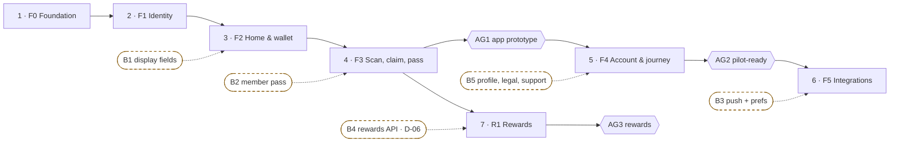
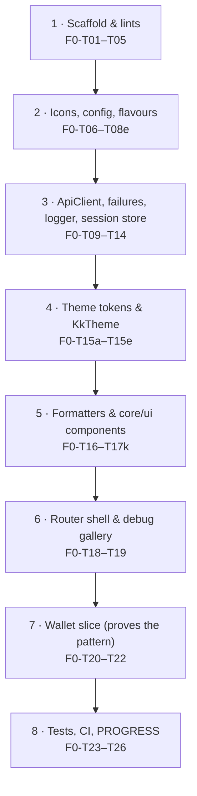
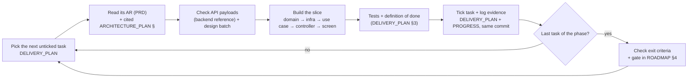

# KataKiu customer app

The Flutter (Android and iOS) app that customers use to:
- sign in;
- scan the concealed one-time code on a purchased product;
- show a temporary pass to an authorised merchant;
- see their confirmed points.

The [Go backend](../katakiu-backend/README.md) is authoritative for eligibility, codes, claims and points; the app only displays server results. It builds as two flavours, **dev** and **prod**.

> **Status:** planning complete, **F0 not started**, no Flutter project yet. Progress: 0 / 109 tasks (see [PROGRESS.md](PROGRESS.md)).
> **Workspace:** `katakiu-backend` and `katakiu-app` must be **sibling folders**. The backend API reference and test accounts are on backend branch `feat/seed-endpoint-tests-api-docs` until PR #2 merges into `develop`. Taking over? See [§8](#8-taking-over-handoff-checklist).

## 1. Start here: reading order

| # | Read | Why |
|---|---|---|
| 1 | [AGENTS.md](AGENTS.md) | The rules: MVP first, client-side invariants, flavours, theme tokens, which trackers to update |
| 2 | [PRD.md](PRD.md) | **What** to build: requirements AR-01–14 and their acceptance criteria |
| 3 | [ROADMAP.md](ROADMAP.md) | **When**: phase order, proposed weeks, gates AG1–AG3 |
| 4 | [ARCHITECTURE_PLAN.md](ARCHITECTURE_PLAN.md) | **How**: see the key sections listed below this table |
| 5 | [DELIVERY_PLAN.md](DELIVERY_PLAN.md) | **The task list**: 109 tasks with IDs and done criteria. Work happens here |
| 6 | [PROGRESS.md](PROGRESS.md) | **Evidence** for every ticked task |

The key sections of ARCHITECTURE_PLAN:

| Section | Topic |
|---|---|
| [§3.1](ARCHITECTURE_PLAN.md#31-setting-up-the-architecture) | Setup |
| [§3.2](ARCHITECTURE_PLAN.md#32-flavours-dev-and-prod) | Flavours |
| [§5](ARCHITECTURE_PLAN.md#5-screens-and-ui-components) | Screens and widgets |
| [§6.0](ARCHITECTURE_PLAN.md#60-endpoint-consumption-by-screen) | Endpoints per screen |
| [§8](ARCHITECTURE_PLAN.md#8-errors-timeouts-and-offline) | Errors |
| [§10](ARCHITECTURE_PLAN.md#10-theme-and-design-tokens) | Theme |
| [§16](ARCHITECTURE_PLAN.md#16-backend-endpoints-done-and-missing) | Backend gaps |

Designs live in `katakiu_mobile_ui_production/`, with tokens in [DESIGN.md](katakiu_mobile_ui_production/mobile_loyalty_verification/DESIGN.md). Business rules come from the backend [PRD](../katakiu-backend/PRD.md) and [AGENTS](../katakiu-backend/AGENTS.md).

## 2. Order of implementation

### 2.1 Phase sequence



**Reading the chart:**
- Phases run **in order**. A phase starts only when the previous phase's exit criteria are met.
- Dashed nodes are backend work, tracked in the backend repo. The app never waits for them: each blocked feature ships with its fallback ([DELIVERY_PLAN §5](DELIVERY_PLAN.md#5-backend-blockers)).
- F5 parts and R1 start only when their prerequisites exist.

### 2.2 Phases in order

| # | Phase | Build in this order (task IDs) | Screens | Endpoints | Requirements | Exit / gate |
|---|---|---|---|---|---|---|
| 1 | **F0 Foundation** | See §2.3 below | Shell, Home balance | LO-01 | AR-02, AR-05 | Both flavours boot; analysis clean; CI green; seeded balance shown |
| 2 | **F1 Identity** | Secure storage (T01) → domain (T02) → secure store and repo (T03–T04) → use cases (T05) → session controller and redirect (T06–T07) → screens (T08–T12) → invalidation (T13) → tests (T14) → manual run (T15) | welcome, phone_entry, otp_verify, eligibility_gate | ID-01–05, ID-11 | AR-01–03 | Sign-in, restore and sign-out on Android and iOS |
| 3 | **F2 Home & wallet** | intl (T01) → domain (T02) → repos (T03) → use cases (T04) → providers (T05) → home (T06–T07) → activity and details (T08–T09) → account screens (T10–T12) → offline reads (T13) → tests (T14) → manual run (T15) | home, activity, transaction_details, account_home, personal_details, points_and_rewards | LO-01, LO-02, CL-09, ID-05 | AR-04–06, AR-10 | All read-only screens match the seed |
| 4 | **F3 Scan, claim, pass** | Packages and permissions (T01) → domain and state machine (T02) → repo (T03) → use cases (T04) → scan controller and screen (T05–T06) → review (T07) → claim and pass controllers (T08–T09) → pass and status screens (T10–T11) → unknown outcome (T12) → "Show my pass" (T13) → tests (T14) → physical devices (T15–T16) | scan, claim_review, claim_pass, claim_status | CL-01–04 | AR-07–11 | Purchase journey on physical Android and iOS, then **gate AG1** |
| 5 | **F4 Account & journey** | Packages (T01) → legal, logout, notifications screens (T02–T05) → strings and accessibility (T06–T07) → integration journey (T08) → release builds of both flavours (T09) | terms_and_privacy, logout_confirm, notification_settings | ID-04 | AR-02, AR-12 | Journey passes; releases run, then **gate AG2** |
| 6 | **F5 Integrations** | Sentry (T01) → Firebase (T02) → device registration (T03) → foreground push (T04) → preferences (T05) → analytics (T06). Each starts only when its prerequisite exists | notification_settings (enabled) | ID-13–16 | AR-13 | Each part meets its own done criterion |
| 7 | **R1 Rewards** | Domain and repo (T01) → screens (T02) → tabs (T03), after D-06 | rewards screens | RE-01–07 | AR-14 | **Gate AG3** |

### 2.3 Order inside F0 (the foundation)

Everything later builds on F0, so follow this order:



**Why this order:**
- **Flavours come before any feature code.** App IDs, config and the cleartext rules shape every later build.
- **The API client and theme come before the UI**, because every screen depends on both.
- **The wallet slice comes last.** It exercises all the layers once, from domain to screen, before F1 copies the pattern.

## 3. The loop for every task



**Rules for the loop:**
- **Never start a phase** before the previous phase's exit criteria are met.
- **Blocked tasks** keep `[ ]` with `**blocked by Bn**`. Never tick a task by stubbing out its dependency.
- **A task is done only with evidence:** a test name, command output or a device note.
- **Changing a requirement** means updating PRD → ARCHITECTURE_PLAN → DELIVERY_PLAN together (AGENTS §9).

## 4. Prerequisites

| Need | For |
|---|---|
| Flutter SDK (stable; version recorded in PROGRESS at F0-T04) | Everything |
| Xcode with an iOS simulator, and Android Studio with an emulator | F0 onwards |
| The local backend: in `../katakiu-backend`, run the migrations, then `make seed` | F0-T22 onwards. Test accounts are in [TEST_ACCOUNTS.md](../katakiu-backend/docs/TEST_ACCOUNTS.md) |
| A physical Android device and a physical iOS device | F3 (scanning and the pass) |
| Accounts for Sentry, Firebase (dev and prod), and the Apple and Google stores | F5 and AG2 |

## 5. Run and build (once F0 is done)

```bash
# dev on an emulator, against the local backend
flutter run --flavor dev --dart-define-from-file=config/dev.json

# dev on a physical device (your LAN IP in the git-ignored config/dev.local.json)
flutter run --flavor dev --dart-define-from-file=config/dev.local.json

# checks
dart format --set-exit-if-changed . && flutter analyze && flutter test

# integration journey (dev + seeded backend only)
flutter test integration_test --flavor dev --dart-define-from-file=config/dev.json

# prod release builds (authorised use only; secrets come from CI)
flutter build appbundle --flavor prod --dart-define-from-file=config/prod.json --obfuscate --split-debug-info=build/symbols
flutter build ipa       --flavor prod --dart-define-from-file=config/prod.json --obfuscate --split-debug-info=build/symbols
```

The full command table is in [ARCHITECTURE_PLAN §3.2](ARCHITECTURE_PLAN.md#32-flavours-dev-and-prod).

## 6. Document map

| Document | Answers | Changes when |
|---|---|---|
| **README.md** (this file) | Where to start and the order of work | The phase order changes |
| [AGENTS.md](AGENTS.md) | How to work in this repo | The working rules change |
| [PRD.md](PRD.md) | What the app must do | An app requirement changes |
| [ROADMAP.md](ROADMAP.md) | When, and the gates | The sequence or staffing changes |
| [ARCHITECTURE_PLAN.md](ARCHITECTURE_PLAN.md) | How it is built | A design decision changes |
| [DELIVERY_PLAN.md](DELIVERY_PLAN.md) | Which tasks to tick | Every work session |
| [PROGRESS.md](PROGRESS.md) | The evidence | Every work session |
| Backend [PRD](../katakiu-backend/PRD.md) / [API reference](../katakiu-backend/docs/api/reference/README.md) | Business rules / real payloads | The backend changes |

## 7. Conventions at a glance

- **Commits and PRs** carry task IDs, e.g. `feat(claims): F3-T09 pass countdown`. Use one branch and PR per phase, or per screen for F2 and F3.
- **Definition of done:** [DELIVERY_PLAN §3](DELIVERY_PLAN.md#3-definition-of-done-every-task). This includes both flavours, no raw styling outside `core/theme`, and no secrets in logs.
- **When F0-T01 runs `flutter create`,** keep this README and add any generated details to it. Do not let the template overwrite it.

## 8. Taking over (handoff checklist)

Use this checklist when you pick up the work mid-way, as a new developer or another model.

1. **Workspace layout.** Clone `katakiu-backend/` and `katakiu-app/` as **sibling folders**; every `../katakiu-backend/...` link depends on it. The backend must be on `develop` with PR #2 merged. Until that merge, use branch `feat/seed-endpoint-tests-api-docs`, which holds the API reference, `TEST_ACCOUNTS.md` and the seed loader.
2. **Read the state.**
   - [PROGRESS.md](PROGRESS.md): "Resume here", the last session and its next action.
   - [DELIVERY_PLAN.md](DELIVERY_PLAN.md): the current phase status and the open questions (§6).
3. **Verify the state.** Run `flutter analyze` and `flutter test` (from F0 onward).
   - If the results disagree with the ticked tasks, trust the code and tests.
   - Untick what is not actually done, and log the discrepancy in PROGRESS.md.
4. **Check the backend version.**
   - Compare the backend commit recorded in PROGRESS.md with your checkout.
   - If it differs, follow the API drift rule in [AGENTS.md §4](AGENTS.md#4-api-consumption-rules).
5. **Read the rules.** [AGENTS.md](AGENTS.md) applies to every task. Do not decide open questions or business decisions yourself.
6. **Continue.** Pick the next unticked task and follow the loop in §3.
