# KataKiu customer app: delivery roadmap

> **Status:** proposed. Prepared 29 October 2026. App work has not started.
> **Related documents:** requirements in [PRD](PRD.md) · tasks in [DELIVERY_PLAN](DELIVERY_PLAN.md) · evidence in [PROGRESS](PROGRESS.md) · design in [ARCHITECTURE_PLAN](ARCHITECTURE_PLAN.md) · backend [ROADMAP](../katakiu-backend/ROADMAP.MD)

## MVP first: keep it simple

The order is set by what a customer can do end to end: sign in → see points → claim and present → recover. Each phase ships working screens against live endpoints. Planned features wait behind their fallback instead of being half-built.

## 1. Baseline

| Item | State |
|---|---|
| Backend | MVP merged: 41 of 141 operations are live, including all 13 customer endpoints the prototype needs ([ARCHITECTURE_PLAN §16.1](ARCHITECTURE_PLAN.md#161-done-live)) |
| App | Planning documents only; no Flutter project yet |
| Backend roadmap window for the customer app | "W4 first screens, W5–W10 completion" (backend ROADMAP §4) |
| Calendar | **A-weeks** are counted from the day app work starts. They are **proposed** and assume one Flutter developer working full time. Staffing and the start date are not agreed |

## 2. Timeline (proposed)

```mermaid
gantt
    title Customer app (A-weeks from app start, proposed)
    dateFormat  X
    axisFormat  A%s
    section App
    F0 Foundation + flavours      :f0, 1, 2
    F1 Identity                   :f1, after f0, 1
    F2 Home & wallet              :f2, after f1, 1
    F3 Scan, claim, pass          :f3, after f2, 2
    AG1 app prototype gate        :milestone, ag1, after f3, 0
    F4 Account, a11y, journey     :f4, after f3, 1
    AG2 pilot-ready gate          :milestone, ag2, after f4, 0
    section Gated
    F5 Integrations (as prerequisites land) :f5, after f4, 2
    R1 Rewards (after D-06)       :r1, after f5, 2
    section Backend (tracked in katakiu-backend)
    B1 display fields (before F2 full detail) :b1, 2, 3
    B3 push devices + prefs (before F5)       :b3, 4, 3
    B5 profile/legal/eligibility/support      :b5, 4, 4
```

**Reading the chart:**
- **Proposed weeks.** These are the durations above: F0 takes 2 weeks, F1 and F2 1 week each, F3 2 weeks and F4 1 week. **AG1 falls at about A6 and AG2 at about A7.**
- **What can slip.** F5 and R1 depend on external prerequisites, so their bars are placeholders. B2 (member pass) and B4 (rewards) are not drawn because they wait on decisions (Q3, D-06).

## 3. Phases

| Phase | Outcome | Requirements (PRD) | Exit criteria (from DELIVERY_PLAN) | Backend dependencies |
|---|---|---|---|---|
| F0 | Wired, tested skeleton; dev and prod flavours; theme and shared UI; wallet balance as the first real slice | AR-02 (client), AR-05 | Boots on an emulator and a simulator in both flavours; analysis clean; CI green; Home shows the seeded balance | None |
| F1 | Sign-in, restore, sign-out | AR-01, AR-02, AR-03 | Sign-in, restore and sign-out work on Android and iOS; no dev-token code left | B5 for eligibility submission only |
| F2 | All read-only screens | AR-04, AR-05, AR-06, AR-10 (offline reads) | Every read-only screen matches the seed; no placeholder data | B1 for the full transaction detail |
| F3 | Purchase journey on physical devices | AR-07, AR-08, AR-09, AR-10, AR-11 | Scan → pass → merchant confirmation → status works on physical Android and iOS; every claim state renders | B2 optional |
| F4 | Remaining screens, accessibility, journey test, release builds | AR-02 (logout), AR-12 | The integration journey passes on dev; release builds of both flavours run on both platforms | B5 for legal texts and support |
| F5 | Monitoring, push, analytics | AR-13 | Each part has its own done criterion | B3, plus Sentry DSN, FCM/APNs and a consent policy |
| R1 | Rewards and redemption | AR-14 | To be defined once D-06 is decided | B4, D-06 |

## 4. Gates

Tick a gate only with evidence recorded in [PROGRESS.md](PROGRESS.md).

### AG1: app prototype (after F3)

AG1 supplies the customer side of backend gate G1.

- [ ] F0–F3 are done in DELIVERY_PLAN, with their exit criteria met.
- [ ] On the **dev** flavour with physical devices, a customer claims a seeded code, presents the pass, and sees the merchant-confirmed result. Customer and outlet points stay separate; the outlet side is checked in the merchant PWA or the API.
- [ ] A duplicate scan, an already-used code and an expired claim produce their error states, with no extra points.
- [ ] An interrupted claim request is resolved by a status check without repeating the action (F3-T12 evidence).
- [ ] Expected, pending and available points are visibly distinct (AR-05).
- [ ] Open questions and limitations are recorded in DELIVERY_PLAN §6 and PROGRESS.md.

### AG2: pilot-ready app (after F4)

AG2 is an input to backend gate G2.

- [ ] F4 is done. The release builds of **both flavours** pass the prod checks in F4-T09 (https, no debug routes, no cleartext, warnings-only logs).
- [ ] The prod config points at the pilot backend; it is confirmed by the owner, and no secrets are in git.
- [ ] Sentry is live in prod with redaction verified (F5-T01).
- [ ] Push is live (F5-T02 to F5-T04), **or** an owner-approved decision to pilot with polling only.
- [ ] The app is distributed to pilot testers through the internal testing track or TestFlight (Q6).
- [ ] The accessibility pass is done (F4-T07).
- [ ] Q1 (platforms), Q2 (languages) and Q8 (app IDs) are decided and recorded.
- [ ] The backend blockers needed for the pilot scope are resolved, or their fallbacks are accepted by the owner (B1, B5).

### AG3: rewards (after R1)

- [ ] D-06 is decided, and backend RE-01–07 are live (B4).
- [ ] R1 is done, including the unknown-outcome handling for redemption (batch 11 pattern).

## 5. Backend alignment

The backend work is tracked in the backend's [DELIVERY_PLAN](../katakiu-backend/docs/implementation/DELIVERY_PLAN.md) and [ENDPOINT_INDEX](../katakiu-backend/docs/implementation/ENDPOINT_INDEX.md). This table states **when the app needs each item**, so the backend can schedule it.

| Blocker | Backend work | App needs it by | Effect of slipping |
|---|---|---|---|
| B1 | Outlet, product, `confirmed_at` (and a decision on `balance_after`) in LO-02/CL-02/CL-09 | Before AG2, ideally around A3 for F2 | Transaction details stays reduced; still acceptable for the prototype |
| B2 | Member pass credential and merchant resolve | Only if Q3 says "standalone pass" | "Show my pass" keeps using the pending claim |
| B3 | ID-15/16, then ID-13/14 | Before AG2 if the pilot needs push | Pilot runs with polling (needs owner approval) |
| B4 | RE-01–07 plus the movement model | After D-06 | No rewards in the pilot app |
| B5 | ID-06, ID-09, ID-10, ID-12, OP-04/05 | ID-09/ID-10 before AG2 if consent is a pilot requirement (FR-02) | Static legal pages; consent recording is missing (owner decision) |

## 6. Risks

| Risk | Effect | Mitigation |
|---|---|---|
| QR scanning varies across low-end Android devices and lighting | F3 slips; failed claims at the counter | Test early on physical devices (F3-T15/16); manual entry is always available |
| Flutter's flavour API (`appFlavor`) behaves differently than assumed | F0 rework | Confirm on the installed SDK at F0-T08d |
| B1 display fields don't land | Transaction details looks sparse in the pilot | Accept the reduced view; fields are hidden, never faked |
| Member-pass decision (Q3) stays open | Ambiguity on the "Show my pass" button | Default to the pending claim's pass |
| FCM/APNs and store accounts are late | Push and distribution block AG2 | Start the account requests during F1; polling is the fallback |
| Store review time | Pilot start slips | Use internal track and TestFlight only for the pilot |
| A single developer | The schedule is fragile | Phases are vertical slices; each can ship and be reviewed independently |

## 7. Tracking discipline

- **Tasks:** tick them in [DELIVERY_PLAN.md](DELIVERY_PLAN.md) only with evidence, and log the evidence in [PROGRESS.md](PROGRESS.md) in the same change.
- **Gates (§4):** tick only when every item has evidence. Record the date in the change log below.
- **Phase status** in DELIVERY_PLAN must agree with this roadmap.
- **Changes:** a requirement change updates [PRD](PRD.md), [ARCHITECTURE_PLAN](ARCHITECTURE_PLAN.md) and [DELIVERY_PLAN](DELIVERY_PLAN.md) together. A schedule change updates §2 here and records why.

### Change log

| Date | Change |
|---|---|
| 2026-10-29 | Created: phases F0–F5 and R1, gates AG1–AG3, backend alignment B1–B5 |
